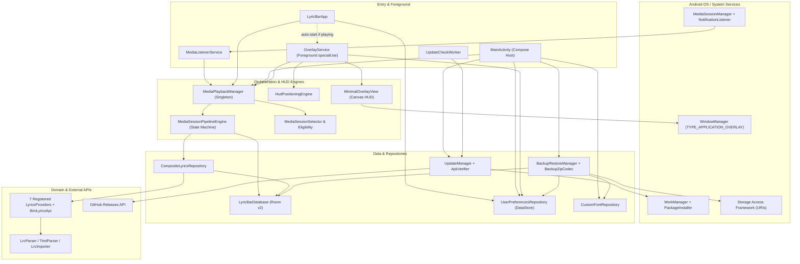
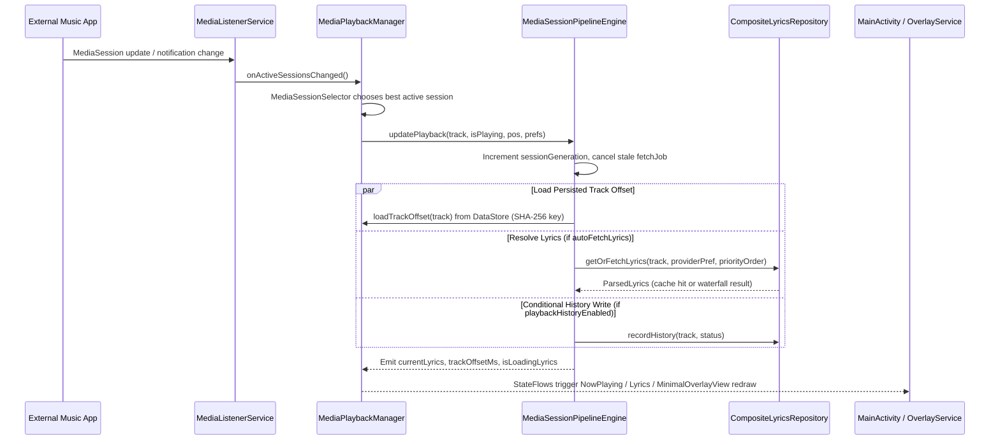
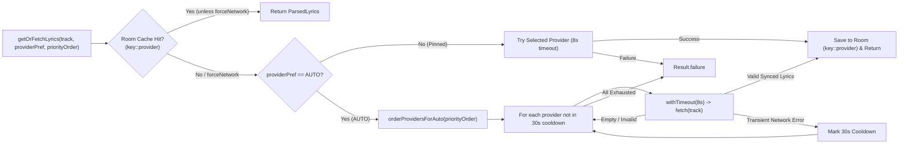
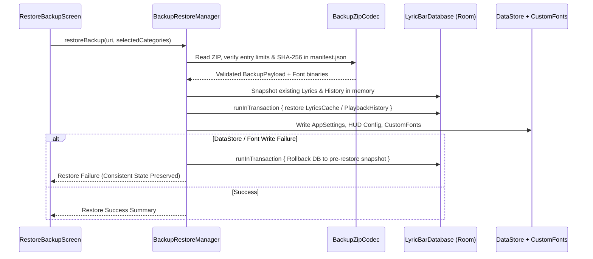
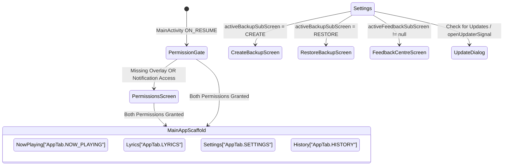

# LYRICBAR — Master Repository Context & Architecture Reference

> **Document Purpose:** Permanent technical architecture, codebase map, and operational rulebook for AI coding agents and maintainers working on **LyricBar**.
> **Audit Date:** 2026-11-28
> **Repository Root:** `c:\AndroidProjects\LyricBar-main` (remote `origin`: `https://github.com/Ishaanj2007/LyricBar.git`)
> **Inspected Branch:** `main`
> **Inspected Commit:** `40f5bb2` + `v2.7.2` bump (`versionCode = 13`, `versionName = "2.7.2"`)
> **Primary Source of Truth:** Current source code overrides `README.md`, release notes, and historical commit descriptions wherever they diverge.

---

## Table of Contents

1. [Project Overview](#1-project-overview)
2. [Repository Identity & Current State](#2-repository-identity--current-state)
3. [Complete Project Structure](#3-complete-project-structure)
4. [Technology Stack & Dependencies](#4-technology-stack--dependencies)
5. [Build Configuration & Variants](#5-build-configuration--variants)
6. [Application Entry Points & Lifecycle](#6-application-entry-points--lifecycle)
7. [Architecture Overview](#7-architecture-overview)
8. [Component & Dependency Map](#8-component--dependency-map)
9. [Feature-by-Feature Implementation](#9-feature-by-feature-implementation)
10. [Lyrics Engine Architecture](#10-lyrics-engine-architecture)
11. [Media Integration](#11-media-integration)
12. [Overlay & HUD Architecture](#12-overlay--hud-architecture)
13. [UI & Design System](#13-ui--design-system)
14. [Background Services & Concurrency](#14-background-services--concurrency)
15. [Permissions & Android System Integration](#15-permissions--android-system-integration)
16. [Data Storage & Persistence](#16-data-storage--persistence)
17. [Networking & External Integrations](#17-networking--external-integrations)
18. [Application Navigation & State Management](#18-application-navigation--state-management)
19. [Build, Test & Release Process](#19-build-test--release-process)
20. [GitHub Repository & Development History](#20-github-repository--development-history)
21. [Known Bugs, Discrepancies & Technical Debt](#21-known-bugs-discrepancies--technical-debt)
22. [Change Impact & Risk Map](#22-change-impact--risk-map)
23. [Testing Coverage & Gaps](#23-testing-coverage--gaps)
24. [Verified Limitations & Unknowns](#24-verified-limitations--unknowns)
25. [Instructions for Future AI Coding Agents](#25-instructions-for-future-ai-coding-agents)
26. [Documentation Maintenance Rules](#26-documentation-maintenance-rules)

---

## 1. Project Overview

**LyricBar** is an Android application (`com.ishaan.lyricbar`, Kotlin + Jetpack Compose + custom Canvas `WindowManager` overlay) that reads active media playback sessions via Android's `NotificationListenerService` / `MediaSessionManager`, fetches synchronized lyrics (LRC, word-synced KRC/enhanced LRC, and TTML) across a sequential multi-provider waterfall, caches results locally in Room, and renders synchronized lyrics both inside the app and in a floating system HUD overlay on top of other apps.

### Core Capabilities Implemented in Source Code
- **Real-Time Media Session Tracking:** Selects the highest-priority active music session across installed players while filtering placeholders, podcasts/audiobooks, and non-music sources.
- **7-Provider Sequential Lyrics Waterfall:** Fetches synchronized lyrics from `LRCLIB`, `lrc.red` (via `BiniLyricsApi` ISRC resolution), `LyricsPlus` (6 concurrent mirrors), `KuGou` (KRC XOR+ZLIB decryption), `Lyrica`, `LiriQo`, and `Unison` (with rich attribution). Users can choose `AUTO` or pin a single provider, and reorder `AUTO` priority via long-press drag-and-drop.
- **Floating Hardware-Accelerated HUD Overlay:** Custom `View` (`MinimalOverlayView`) attached via `WindowManager` (`TYPE_APPLICATION_OVERLAY`) with a `postOnAnimation`-synchronized draw loop, zero-allocation paints, 6 animation styles (`KARAOKE`, `SMOOTH_SLIDE`, `FADE`, `BLUR_REVEAL`, `TYPEWRITER`, `INSTANT`), independent Portrait/Landscape placement profiles, 1-second hold-to-reposition, 2D resize handles, click-through mode, triple-tap launch, customizable backdrop (`BLACK`/`GREY`), custom colors, and dynamic accent extraction from album artwork.
- **In-App Synced Reader & Player Controls:** `NowPlayingScreen` (ambient blurred artwork background, 3-line rolling lyrics preview, 11-bar instrumental indicator, interactive seek bar) and `LyricsScreen` (auto-scrolling synced list, word-synced highlighting, delay offset tuning `-0.5s`/`-0.1s`/`Reset`/`+0.1s`/`+0.5s`, manual search, local `.lrc`/`.txt` import, alignment cycling, Unison attribution links).
- **Custom Fonts Manager:** Single `.ttf`/`.otf` import, multi-entry `.zip` font scanner/importer with ZIP-bomb guards, SFNT magic-header validation, and multi-select batch deletion.
- **Playback History & Toggle:** Room-backed playback history grouped by date (`HistoryScreen`) with a Settings toggle (`Playback History`, DataStore key `PLAYBACK_HISTORY_ENABLED`) that guards new recording without clearing stored rows.
- **Portable Backup & Restore + In-App Updater + Feedback Centre:** ZIP backup/restore codec (`formatVersion = 1`) covering DataStore preferences, Room cache/history, and custom font binaries; GitHub Releases update checker/downloader/verifier/installer; and prefilled GitHub Issue URL builder for bugs and feature requests.

> [!IMPORTANT]
> **Dark-Only UI in Code vs. Legacy Docs/Settings:** Although `ThemeMode` (`FOLLOW_SYSTEM`, `LIGHT`, `DARK`) and light `ColorScheme`s remain defined in `Color.kt`, `Theme.kt`, and backup codecs (and are still described in `README.md`), `MyApplicationTheme` (`app/src/main/java/com/example/ui/theme/Theme.kt:255`) hardcodes `val isDark = true`.

---

## 2. Repository Identity & Current State

| Attribute | Verified Value |
|---|---|
| **Gradle Root Project Name** | `LyricBar` (`settings.gradle.kts`) |
| **Module Structure** | Single-module Gradle project (`include(":app")`) |
| **Application ID** | `com.ishaan.lyricbar` (`app/build.gradle.kts`) |
| **Kotlin / Android Namespace** | `com.example` (`app/build.gradle.kts`) |
| **Version Name / Code** | `2.7.2` / `13` (`app/build.gradle.kts`, `strings.xml`) |
| **SDK Levels** | `minSdk = 24`, `compileSdk = 35`, `targetSdk = 35` |
| **Git Remote (`origin`)** | `https://github.com/Ishaanj2007/LyricBar.git` |
| **Branches** | `main` (checked out), `dev/v2.7.0` (`00be842` local / `b93b83d` on `origin`) |
| **HEAD Commit on `main`** | `559267ba3a23e2a9aeb7eb3c5354cf951b1ee4f7` (`feat: order LyricsScreen provider menu by user priority`) |
| **Untracked Secret/Local Files Present** | `keystore.properties` (present, contents excluded), `local.properties` (present, contents excluded), `debug.keystore` (absent), `debug.keystore.base64` (absent) |

### Working Tree Status at Latest Update (`v2.7.2`)
- Task 3 (*Playback History Toggle*, `15614d5`), Dynamic Accent OKLCH & 3-second Info Dialog (`7a314c2`, `de1ca05`), Playback History 12h/24h & Timezone formatting (`78fea87`), and Dynamic Rotating Lyrics-Loading Messages (`40f5bb2`) are all committed on `main`.
- Only `app/src/scr.zip` (1,584,778 bytes, binary archive not in `.gitignore`) remains untracked.

---

## 3. Complete Project Structure

LyricBar uses a **single `:app` Android module** with code organized under package `com.example` (despite `applicationId = "com.ishaan.lyricbar"`).

### Root & Configuration Files
- `build.gradle.kts` (6 lines) — Root plugin declarations (`android.application`, `kotlin.android`, `kotlin.compose`, `ksp`, `apply false`).
- `settings.gradle.kts` (17 lines) — Plugin management, `FAIL_ON_PROJECT_REPOS`, `rootProject.name = "LyricBar"`, `include(":app")`.
- `gradle.properties` (3 lines) — AndroidX, Jetifier, `-Xmx2048m -Dfile.encoding=UTF-8`.
- `gradle/libs.versions.toml` (55 lines) — Version catalog for AGP, Kotlin, Compose, Room, DataStore, WorkManager, Haze, Palette, OkHttp, Retrofit, testing.
- `gradle/wrapper/gradle-wrapper.properties` (7 lines) — Gradle `8.10.2-bin.zip` with distribution URL validation.
- `.github/workflows/ci.yml` (67 lines) — GitHub Actions CI workflow.
- `.github/ISSUE_TEMPLATE/bug_report.yml` (118 lines) & `feature_request.yml` (53 lines) — GitHub issue form templates.
- `app/build.gradle.kts` (187 lines), `app/proguard-rules.pro` (78 lines) — App module build, signing, KSP schema export, R8 rules.
- `README.md` (296 lines), `LICENSE` (21 lines, MIT), `metadata.json` (6 lines, legacy Google AI Studio template metadata), `.gitignore` (32 lines).

### Main Kotlin Sources (`app/src/main/java/com/example/` — 81 `.kt` files)

#### Application & Activity
- `LyricBarApp.kt` (71 lines) — Application class initializing managers, legacy migration, auto-show overlay collector, periodic/launch update checks.
- `MainActivity.kt` (328 lines) — Edge-to-edge host Activity, permission gating, notification updater intent handling, responsive adaptive tab scaffold.

#### Data Layer (`data/`)
- **Room Database (`data/local/`)**
  - `LyricBarDatabase.kt` (94 lines) — Room DB v2 (`lyricbar_database`), `MIGRATION_1_2`, KSP schema export enabled.
  - `entity/LyricsEntity.kt` (18 lines) — Cached lyrics entity (`lyrics` table, PK `key`).
  - `entity/SongHistoryEntity.kt` (16 lines) — Played track entity (`song_history` table, autoincrement `id` PK).
  - `dao/LyricsDao.kt` (27 lines) — Cache CRUD + clear.
  - `dao/SongHistoryDao.kt` (25 lines) — Upsert, recent query (`LIMIT 100`), clear.
  - `dao/BackupDao.kt` (35 lines) — Unbounded `getAllLyrics()` / `getAllHistory()`, bulk insert/clear for backup & restore.
- **Domain Data Models (`data/model/`)**
  - `LyricLine.kt` (193 lines) — `WordTiming`, `LyricLine`, `LyricsAttribution`, `ParsedLyrics` (binary-search `findActiveIndex`, `displaySource`).
  - `TrackMetadata.kt` (180 lines) — `TrackMetadata` (`baseIdentityKey`, `identityKey`, `lookupKey`, `isValidTrack`, `hasRealMusicAttribution`, `resolveAppName`), `PlaybackStateInfo` (`calculatedPositionMs`).
- **Preferences (`data/preferences/`)**
  - `UserPreferencesRepository.kt` (1506 lines) — DataStore (`lyricbar_prefs`), enums (`LyricsProviderPreference`, `ThemePreset`, `ThemeMode`, `FontOption`, `OverlayAnimationStyle`, `HudBackdropStyle`, `LyricsAlignment`), `UserPreferences`, normalized provider ordering helpers, SHA-256 per-track offset storage & legacy migration.
- **Custom Fonts (`data/fonts/`)**
  - `CustomFontModels.kt` (136 lines) — `CustomFontLimits`, `CustomFontRecord`, `CustomFontRegistryPayload`, import result sealed types.
  - `CustomFontRepository.kt` (685 lines) — Disk storage under `filesDir/custom_fonts`, `registry.json`, SHA-256 dedup, Typeface cache, backup export/restore.
  - `CustomFontValidator.kt` (99 lines) — SFNT magic-byte header validation + `Typeface.createFromFile` verification.
  - `CustomFontZipImporter.kt` (553 lines) — ZIP scanning, staging under `cacheDir/custom_fonts_tmp`, ZIP-slip & decompression bomb guards.
- **Repository (`data/repository/`)**
  - `CompositeLyricsRepository.kt` (666 lines) — Orchestrates 7 providers, sequential priority execution, 8s per-provider timeout, 30s failure cooldown, provider-scoped Room cache (`::provider::`), LRC import save, history writes.
- **Backup & Restore (`data/backup/`)**
  - `BackupModels.kt` (371 lines) — `BackupCategory`, manifest/payload serialization models (`CURRENT_FORMAT_VERSION = 1`).
  - `BackupZipCodec.kt` (794 lines) — JSON/ZIP encoding & decoding with SHA-256 checksums, schema field counts, and archive size/entry limits.
  - `BackupRestoreManager.kt` (981 lines) — SAF stream backup/restore orchestration with DB snapshot rollback on DataStore write errors.
  - `BackupStorageBridge.kt` (132 lines) — Storage abstraction between Room DAOs, DataStore, and `CustomFontRepository`.
- **In-App Updater (`data/updater/`)**
  - `UpdateManager.kt` (414 lines) — UI state coordinator (`StateFlow`) for update check, download, verification, and install flow.
  - `UpdateCheckEngine.kt` (171 lines) — `Mutex`-synchronized check engine with 5-minute debounce and ETag/304 handling.
  - `UpdateRepository.kt` (535 lines) — GitHub Releases API client (`releases/latest` -> `/releases` fallback), ABI APK selector, SHA-256 parser.
  - `ApkDownloader.kt` (165 lines) — Streaming OkHttp download to `cacheDir/updates/` with 20 MB storage headroom check.
  - `ApkVerifier.kt` (224 lines) — Verifies SHA-256, `packageName`, `longVersionCode >`, `VersionComparator >=`, and signing certificate SHA-256 match.
  - `UpdateInstaller.kt` (92 lines) — `FileProvider` URI + `ACTION_VIEW` install intent launcher.
  - `UpdateNotifier.kt` (139 lines) — Notification channel `lyricbar_app_updates` (ID `4001`) + deep-link intent helper.
  - `UpdateCheckScheduler.kt` (102 lines) — 48h `PeriodicWorkRequest` + launch check timing.
  - `UpdateCheckWorker.kt` (63 lines) — `CoroutineWorker` with `MAX_RETRY_ATTEMPTS = 3`.
  - `ReleaseInfo.kt` (83 lines) & `VersionComparator.kt` (92 lines) — Release metadata & semver comparison.

#### Domain Layer (`domain/`)
- **Lyrics Engine & Parsers (`domain/lyricsengine/`, `domain/parser/`)**
  - `LyricsTimingEngine.kt` — Pure timing math for word glow, line reveal, transition, and adaptive scroll progress.
  - `LyricsLoadingMessages.kt` — Shared provider-agnostic rotating lyrics-loading messages (`2800L` ms interval, deterministic per `trackKey`) for `LyricsScreen` and `NowPlayingScreen`.
  - `LyricsSearchQueryBuilder.kt` (68 lines) — Cleans track metadata and constructs Google search URLs for LRC/SRT/TXT.
  - `LrcParser.kt` (228 lines) — Parses `[mm:ss.xxx]` lines, `[offset:]`, `<word>` timestamps, `[x-attribution-*:]`, detects TTML.
  - `TtmlParser.kt` (265 lines) — XXE-hardened DOM XML parser converting TTML `<tt><body>
` into `ParsedLyrics`.
  - `LrcImporter.kt` (182 lines) — 1 MB max SAF LRC reader with UTF-8/UTF-16/BOM/ISO-8859-1 fallback and TTML/binary rejection.
- **Providers (`domain/provider/`)**
  - `LyricsProvider.kt` (24 lines) — Base provider interface.
  - `LyricsMatchingUtils.kt` (253 lines) — ISRC regex (`ISO 3901`), version tag matching (`Live`, `Remix`, `Acoustic`, `Cover`, `Remaster`, `Instrumental`, `Speed`, `Demo`, `Acapella`), title/artist matching, synced line validation.
  - `LrcLibProvider.kt` (225 lines) — LRCLIB API (`/api/get` & `/api/search`).
  - `LrcRedProvider.kt` (265 lines) + `BiniLyricsApi.kt` (323 lines) — ISRC resolver + `lrc.red` static lookup.
  - `LyricsPlusProvider.kt` (477 lines) — 6 concurrent mirrors using Kotlin `select` with loser cancellation & `lastGood` mirror cache.
  - `KugouProvider.kt` (485 lines) — KuGou search + Base64/XOR (`KRC_KEY`)/ZLIB decryption, skips credit metadata lines.
  - `LyricaProvider.kt` (392 lines) — Lyrica HF Space API client.
  - `LiriQoProvider.kt` (532 lines) — LiriQo `/v1/lyrics` & `/v1/lrc` client.
  - `UnisonProvider.kt` (608 lines) — Unison `/lyrics` & `/search` client with ETag cache, 503 retry, TTML/LRC, attribution metadata.
  - `LyricsOvhProvider.kt` (71 lines) — **Unregistered / unused in production** (blocking OkHttp `.execute()`).

#### Service Layer (`service/`)
- `MediaListenerService.kt` (116 lines) — `NotificationListenerService` monitoring `MediaSessionManager` & media notifications.
- `MediaPlaybackManager.kt` (453 lines) — Central playback & controller singleton; 50ms/300ms ticker; forwards preferences to `MediaSessionPipelineEngine`; transport actions.
- `MediaSessionEligibility.kt` (936 lines) — Package categorization (`MediaAppCategory`), eligibility heuristics, `MediaSessionSelector`.
- `MediaSessionPipelineEngine.kt` (742 lines) — Pure-Kotlin coroutine state machine (`sessionGeneration`, `fetchJob`, `offsetJob`, `historyJob`, `playbackHistoryEnabled` + `lyricsProviderOrder`).
- `OverlayService.kt` (879 lines) — Foreground `specialUse` service managing `WindowManager` HUD view, screen/rotation lifecycle, dynamic artwork accent extraction, notification actions.
- `HudPositioningEngine.kt` (528 lines) — Dual Portrait/Landscape bounds & safe-area inset clamping (`HudDisplayMetricsProvider` + `HudPositioningEngine`).
- `ArtworkAccentExtractor.kt` (172 lines) — AndroidX `Palette` extractor with 32-entry LRU cache and WCAG/BT.601 contrast filtering.

#### UI Layer (`ui/`)
- **Theme (`ui/theme/`)**
  - `Color.kt` (188 lines) — 4 curated dark+light palettes (`RoseQuartz`, `LavenderMist`, `PeachEmber`, `SageSerenity`) + legacy names.
  - `Theme.kt` (269 lines) — `MyApplicationTheme` (**forces `val isDark = true`**) + Material You dynamic dark on API 31+.
  - `Type.kt` (233 lines) — 12 bundled font resources + `resolveLyricsFontFamily` cache for custom TTF/OTF paths + typography scales.
- **Reusable Components (`ui/components/`)**
  - `MinimalOverlayView.kt` (2473 lines) — Custom `WindowManager` HUD `View` with hardware Canvas draw loop, 6 animation modes, drag/resize handles, 1s hold-to-reposition, triple-tap, 4 typeface caches.
  - `GlassSurface.kt` (1308 lines) — Haze `FrostedCard`, `TonalSurface`, `CalmThemedBackground`, `ArtworkCanonicalizer`, `ArtworkMemoryCache`, `loadArtworkBitmapSafely`, blurred background & glow bitmaps.
  - `HudGestureControllers.kt` (614 lines) — Hold-to-reposition state/timer, 2D drag/resize edge controller, triple-tap detector.
  - `HudColorPickerDialog.kt` (490 lines) — HSV gradient color picker dialog for HUD lyric colors.
  - `CustomFontZipImportDialog.kt` (417 lines) — Modal flow for ZIP font scan, multi-select, import progress, and summary.
  - `HudTextLayoutEngine.kt` (387 lines) — Pure layout calculator for multiline wrapping & single-line marquee measurements.
  - `SimpleMarkdownView.kt` (341 lines) — Lightweight Markdown renderer for release notes in `UpdateDialog`.
  - `AppNavigation.kt` (306 lines) — `AppTab` enum, `FloatingBottomNavPill`, `AdaptiveNavRail`.
  - `HudColorSystem.kt` (285 lines) — Curated HUD swatches, readability/contrast warnings, hex formatting.
  - `HudVisualSpecs.kt` (201 lines) — Shared backdrop fill/corner/padding and color hierarchy specs.
  - `ProviderReorderLogic.kt` (104 lines) — Swap hysteresis & viewport auto-scroll math for long-press provider reordering.
- **Screens (`ui/screens/`)**
  - `SettingsScreen.kt` (5384 lines) — 12 accordion sections, adaptive 1- or 2-column layout, HUD live previews, unified long-press provider drag list, Backup/Feedback sub-screens.
  - `LyricsScreen.kt` (2897 lines) — Responsive portrait/landscape/two-pane synced lyrics viewer, floating frosted provider menu, delay bar, word-synced highlighter, mini-player.
  - `NowPlayingScreen.kt` (2110 lines) — Responsive portrait/landscape playback showcase, 3-line vertical rolling preview, 11-bar instrumental waveform, seek bar, source chip.
  - `UpdateDialog.kt` (1154 lines) — Multi-state update check/download/verify/install/error modal dialog.
  - `FeedbackCentreScreen.kt` (926 lines) + `FeedbackUrlBuilder.kt` (209 lines) — Tabbed bug report & feature request forms opening prefilled GitHub Issue URLs.
  - `RestoreBackupScreen.kt` (765 lines) & `CreateBackupScreen.kt` (741 lines) & `BackupRestoreState.kt` (83 lines) — SAF ZIP backup creation and transactional restore UI.
  - `HistoryScreen.kt` (704 lines) & `HistoryDateGrouper.kt` (68 lines) — Date-grouped played track list with status chips and clear/navigation actions.
  - `AboutDeveloperSection.kt` (595 lines) & `DeveloperConfig.kt` (7 lines) — App version, auto-update toggle, manual check, feedback & developer links.
  - `PermissionsScreen.kt` (405 lines) — Onboarding/permission gate for Overlay (`SYSTEM_ALERT_WINDOW`) and Notification Access.

### Tests, Schemas & Resources
- **Unit Tests (`app/src/test/java/com/example/`):** 57 `.kt` files containing **482 `@Test` annotations**.
- **Instrumented Tests (`app/src/androidTest/java/com/example/`):** 2 `.kt` files (`ExampleInstrumentedTest.kt`, `RoomMigrationIntegrationTest.kt`) containing **2 `@Test` annotations**.
- **Room Exported Schemas (`app/schemas/com.example.data.local.LyricBarDatabase/`):** `1.json` (132 lines), `2.json` (138 lines).
- **Resources (`app/src/main/res/`):** 12 `.ttf` fonts under `res/font/`, launcher icons (`res/drawable/lyricbarlogo.png`, `mipmap-*`), `ic_notification_update.xml`, `values/{colors.xml, strings.xml, themes.xml}`, `xml/{backup_rules.xml, data_extraction_rules.xml, file_paths.xml}`.

---

## 4. Technology Stack & Dependencies

All dependency versions are declared in `gradle/libs.versions.toml` and applied in `app/build.gradle.kts`.

| Category | Library / Coordinate | Declared Version | Actual Usage Verified in Source Code |
|---|---|---|---|
| **Build & Toolchain** | Android Gradle Plugin (`com.android.application`) | `8.7.2` | Active build system |
| **Language** | Kotlin (`org.jetbrains.kotlin.android`, `plugin.compose`) | `2.0.21` | Entire codebase, JVM target 17 |
| **Annotation Processing** | KSP (`com.google.devtools.ksp`) | `2.0.21-1.0.25` | Active for Room compiler (`room-compiler`) |
| **Async** | `kotlinx-coroutines-android`, `kotlinx-coroutines-test` | `1.9.0` | Heavy usage across services, providers, DataStore, updater, tests |
| **Android Core / Lifecycle** | `androidx.core:core-ktx` (`1.15.0`), `lifecycle-runtime-ktx` / `lifecycle-runtime-compose` (`2.8.7`), `activity-compose` (`1.9.3`) | `1.15.0` / `2.8.7` / `1.9.3` | Active in `LyricBarApp`, `MainActivity`, SAF launchers, `collectAsStateWithLifecycle` |
| **UI Toolkit** | Jetpack Compose BOM (`2024.10.01`), `ui`, `material3`, `material-icons-extended` | `2024.10.01` BOM | Active across all screens and custom components |
| **Blur / Glass** | `dev.chrisbanes.haze:haze` | `1.3.1` | Active in `GlassSurface.kt`, `AppNavigation.kt`, `LyricsScreen.kt`, `SettingsScreen.kt` |
| **Image / Color** | `androidx.palette:palette-ktx` | `1.0.0` | Active in `ArtworkAccentExtractor.kt` |
| **Navigation** | `androidx.navigation:navigation-compose` | `2.8.3` | **DECLARED BUT UNUSED** — `MainActivity.kt` uses custom `AppTab` + `AnimatedContent` |
| **Persistence (DB)** | `androidx.room:room-runtime`, `room-ktx`, `room-compiler`, `room-testing` | `2.6.1` | Active (`LyricBarDatabase`, DAOs, `RoomMigrationIntegrationTest`) |
| **Persistence (Prefs)** | `androidx.datastore:datastore-preferences` | `1.1.1` | Active (`UserPreferencesRepository`, `lyricbar_prefs`) |
| **Background Work** | `androidx.work:work-runtime-ktx` | `2.10.0` | Active (`UpdateCheckScheduler`, `UpdateCheckWorker`) |
| **Networking** | `com.squareup.okhttp3:okhttp` | `4.12.0` | Active across all 7+1 lyrics providers, `BiniLyricsApi`, `UpdateRepository`, `ApkDownloader` |
| **HTTP Logging** | `com.squareup.okhttp3:logging-interceptor` | `4.12.0` | **DECLARED BUT UNUSED** — Zero imports in `app/src` |
| **REST / JSON** | `com.squareup.retrofit2:retrofit`, `converter-gson` | `2.11.0` | **Retrofit UNUSED directly** (zero `retrofit2` imports); `com.google.gson` is used heavily (`BackupZipCodec`, `CustomFontRepository`, `UpdateRepository`, 6 providers, tests) and enters **transitively** via `converter-gson` |
| **Testing** | `junit` (`4.13.2`), `androidx.test.ext:junit` (`1.2.1`), `espresso-core` (`3.6.1`), `robolectric` (`4.13`), `mockwebserver` (`4.12.0`), `work-testing` (`2.10.0`) | See left | Active across unit tests & instrumented tests |

> [!WARNING]
> **Transitive Gson Dependency Trap:** `com.google.gson` is NOT declared directly in `libs.versions.toml` or `app/build.gradle.kts`; it compiles only because `retrofit2:converter-gson` pulls it in transitively. Removing Retrofit without adding `com.google.code.gson:gson` explicitly would break compilation of backup, custom fonts, updater, and providers.

---

## 5. Build Configuration & Variants

### Gradle Settings & Properties
- `settings.gradle.kts`: `RepositoriesMode.FAIL_ON_PROJECT_REPOS` restricts dependencies to `google()` and `mavenCentral()`. Root project name is `"LyricBar"`, single included module `:app`.
- `gradle.properties`: `android.useAndroidX=true`, `android.enableJetifier=true`, `org.gradle.jvmargs=-Xmx2048m -Dfile.encoding=UTF-8`.
- `gradle/wrapper/gradle-wrapper.properties`: Gradle `8.10.2-bin.zip`, `validateDistributionUrl=true`.

### Root vs. `app/build.gradle.kts`
- Root `build.gradle.kts` is 6 lines defining plugin aliases (`apply false`). **Discrepancy:** `README.md` documents a debug keystore restoration hook reading `debug.keystore.base64` in root `build.gradle.kts`; this hook does **not** exist in the current file, and `debug.keystore.base64` is absent from the workspace.
- `app/build.gradle.kts`:
  - `namespace = "com.example"`, `applicationId = "com.ishaan.lyricbar"`.
  - `compileSdk = 35`, `minSdk = 24`, `targetSdk = 35`, `versionCode = 13`, `versionName = "2.7.2"`.
  - Java 17 (`JavaVersion.VERSION_17`), Kotlin JVM target `"17"`.
  - `buildFeatures { compose = true; buildConfig = true }`.
  - `ksp { arg("room.schemaLocation", "$projectDir/schemas") }`, wired into `sourceSets["test"].assets` and `sourceSets["androidTest"].assets`.
  - **Build Types:**
    - `debug`: Uses `signingConfigs.getByName("debug")` when `${rootDir}/debug.keystore` exists (currently absent, falling back to Android default debug keystore).
    - `release`: `isMinifyEnabled = true`, `isShrinkResources = true`, ProGuard (`proguard-android-optimize.txt` + `proguard-rules.pro`). Reads signing properties `LYRICBAR_STORE_FILE`, `LYRICBAR_STORE_PASSWORD`, `LYRICBAR_KEY_ALIAS`, `LYRICBAR_KEY_PASSWORD` from Gradle properties, environment variables, or root `keystore.properties`. Fails in `gradle.taskGraph.whenReady` with a `GradleException` if any release signing property is missing when a release task runs.
- `app/proguard-rules.pro` (78 lines): Keeps `UpdateCheckWorker`, `LyricBarDatabase_Impl`, Room entities (`com.example.data.local.entity.**`), preferences enums (`com.example.data.preferences.**`), Gson `@SerializedName` and backup models (`com.example.data.backup.**`), `CustomFontRecord`/`CustomFontRegistryPayload`, and OkHttp rules.

---

## 6. Application Entry Points & Lifecycle

### Manifest Components (`app/src/main/AndroidManifest.xml`)
1. **`LyricBarApp`** (`android:name=".LyricBarApp"`):
   - Initialized at process start. Instantiates `MediaPlaybackManager` and `UserPreferencesRepository`.
   - Runs `migrateLegacyPreferencesIfNeeded()` in background scope.
   - Collects `combine(playbackState, userPreferencesFlow)` on `Dispatchers.Main`: auto-starts `OverlayService` (`ContextCompat.startForegroundService`) whenever `overlayEnabled && autoShowOnPlayback && state.isPlaying && Settings.canDrawOverlays(this)`.
   - Launches IO coroutine for `UpdateNotifier(this).ensureNotificationChannel()`, `UpdateCheckScheduler.syncPeriodicSchedule(this, prefs.autoUpdateChecksEnabled)`, and launch update check if `UpdateCheckScheduler.shouldCheckOnAppLaunch(...)` holds.
2. **`MainActivity`** (`exported="true"`, `LAUNCHER`):
   - Calls `enableEdgeToEdge()`.
   - Inspects `UpdateNotifier.isOpenUpdaterIntent(intent)` in `onCreate` and `onNewIntent` to route directly into Settings -> About -> `UpdateDialog`.
   - Checks `Settings.canDrawOverlays(this)` and Notification Listener enabled state on `Lifecycle.Event.ON_RESUME`; shows `PermissionsScreen` until both are granted, then renders `MainAppScaffold`.
   - Requests `POST_NOTIFICATIONS` once on Android 13+ (API 33+) when `autoUpdateChecksEnabled` is true.
3. **`OverlayService`** (`exported="false"`, `foregroundServiceType="specialUse"`):
   - Foreground service started explicitly by `NowPlayingScreen` toggle, `LyricBarApp` auto-show collector, or notification actions (`ACTION_STOP_SERVICE`, `ACTION_TOGGLE_DRAG`).
   - Attaches/detaches `MinimalOverlayView` on `WindowManager` and reacts to screen off/on, display changes, and configuration/orientation changes.
4. **`MediaListenerService`** (`exported="true"`, permission `BIND_NOTIFICATION_LISTENER_SERVICE`):
   - System-bound `NotificationListenerService`. Registers `MediaSessionManager.OnActiveSessionsChangedListener` and handles `onNotificationPosted`/`onNotificationRemoved` to trigger `MediaPlaybackManager` session refreshes.
5. **`UpdateCheckWorker`** (WorkManager `CoroutineWorker`):
   - Scheduled periodically every 48 hours (`UpdateCheckScheduler`) with `NetworkType.CONNECTED` constraint and up to `MAX_RETRY_ATTEMPTS = 3`.
6. **`FileProvider`** (`${applicationId}.fileprovider`, authorities `com.ishaan.lyricbar.fileprovider`):
   - Exposes `cache-path` (`updates/`) and `files-path` for APK installation intents (`UpdateInstaller`).

---

## 7. Architecture Overview

LyricBar implements a **layered reactive architecture** built around **manual singletons**, **Kotlin `StateFlow`/`Flow` streams**, and **pure-Kotlin testable state machines / calculation engines**, rather than Hilt/Koin DI or AndroidX `ViewModel`s.

- **UI Layer (`ui/`):** Stateless/stateful Jetpack Compose screens observing `MediaPlaybackManager` and `UserPreferencesRepository` flows via `collectAsStateWithLifecycle()`. Complex gesture, color, layout, and reordering math is factored into pure helpers (`HudPositioningEngine`, `HudTextLayoutEngine`, `HudVisualSpecs`, `HudColorSystem`, `ProviderReorderLogic`, `SettingsAccordionState`, `HistoryDateGrouper`, `FeedbackUrlBuilder`).
- **Service / Orchestration Layer (`service/`):** `MediaPlaybackManager` bridges Android `MediaController` callbacks + 50ms/300ms ticker with the pure-Kotlin `MediaSessionPipelineEngine` state machine. `OverlayService` manages the Android `WindowManager` window and feeds `MinimalOverlayView`.
- **Domain Layer (`domain/`):** Pure-ish parsers (`LrcParser`, `TtmlParser`, `LrcImporter`), timing/matching engines (`LyricsTimingEngine`, `LyricsMatchingUtils`, `LyricsSearchQueryBuilder`), and OkHttp-based `LyricsProvider` implementations.
- **Data Layer (`data/`):** `CompositeLyricsRepository` unifies provider calls + Room caching (`LyricBarDatabase`), `UserPreferencesRepository` wraps Jetpack Preferences DataStore, `CustomFontRepository` manages local font files, `BackupRestoreManager` handles atomic portable ZIP backup/restore, and `UpdateManager` coordinates GitHub release checks/verification.

### High-Level Architecture Diagram

### End-to-End Playback-to-HUD Data Flow

---

## 8. Component & Dependency Map

| Component | File Path | Depends On | Depended On By |
|---|---|---|---|
| `LyricBarApp` | `app/src/main/java/com/example/LyricBarApp.kt` | `MediaPlaybackManager`, `UserPreferencesRepository`, `OverlayService`, `UpdateCheckScheduler`, `UpdateNotifier` | Android runtime (Application) |
| `MainActivity` | `app/src/main/java/com/example/MainActivity.kt` | `MediaPlaybackManager`, `UserPreferencesRepository`, `UpdateNotifier`, UI screens, `AppNavigation` | Launcher / `OverlayService` triple-tap / `UpdateNotifier` |
| `MediaPlaybackManager` | `app/src/main/java/com/example/service/MediaPlaybackManager.kt` | `MediaSessionEligibility`, `MediaSessionPipelineEngine`, `CompositeLyricsRepository`, `UserPreferencesRepository`, `LyricBarDatabase` | `LyricBarApp`, `MainActivity`, `MediaListenerService`, `OverlayService`, screens |
| `MediaSessionPipelineEngine` | `app/src/main/java/com/example/service/MediaSessionPipelineEngine.kt` | `PlaybackStateInfo`, `ParsedLyrics`, `UserPreferences` callbacks (`LyricsDataSource`) | `MediaPlaybackManager`, unit tests |
| `CompositeLyricsRepository` | `app/src/main/java/com/example/data/repository/CompositeLyricsRepository.kt` | `LyricsDao`, `SongHistoryDao`, 7 `LyricsProvider`s, `LrcParser`, `TtmlParser`, `OkHttpClient` | `MediaPlaybackManager`, `LyricsScreen`, `SettingsScreen` |
| `UserPreferencesRepository` | `app/src/main/java/com/example/data/preferences/UserPreferencesRepository.kt` | Jetpack DataStore (`lyricbar_prefs`), `CustomFontModels`/`BackupModels` codecs | `LyricBarApp`, `MainActivity`, `MediaPlaybackManager`, `OverlayService`, `BackupStorageBridge`, screens |
| `OverlayService` | `app/src/main/java/com/example/service/OverlayService.kt` | `MediaPlaybackManager`, `UserPreferencesRepository`, `CustomFontRepository`, `HudPositioningEngine`, `ArtworkAccentExtractor`, `MinimalOverlayView` | `LyricBarApp`, `NowPlayingScreen`, Notification actions |
| `MinimalOverlayView` | `app/src/main/java/com/example/ui/components/MinimalOverlayView.kt` | `HudVisualSpecs`, `HudTextLayoutEngine`, `HudColorSystem`, `HudGestureControllers`, `HudPositioningEngine`, `LyricsTimingEngine` | `OverlayService` |
| `CustomFontRepository` | `app/src/main/java/com/example/data/fonts/CustomFontRepository.kt` | `CustomFontValidator`, `UserPreferencesRepository` sync, `filesDir/custom_fonts`, `Gson` | `CustomFontZipImporter`, `SettingsScreen`, `LyricsScreen`, `OverlayService`, `BackupStorageBridge` |
| `BackupRestoreManager` | `app/src/main/java/com/example/data/backup/BackupRestoreManager.kt` | `BackupZipCodec`, `BackupStorageBridge` (`LyricBarDatabase`, `UserPreferencesRepository`, `CustomFontRepository`) | `CreateBackupScreen`, `RestoreBackupScreen` |
| `UpdateManager` | `app/src/main/java/com/example/data/updater/UpdateManager.kt` | `UpdateCheckEngine`, `UpdateRepository`, `ApkDownloader`, `ApkVerifier`, `UpdateInstaller`, `UserPreferencesRepository` | `MainActivity`, `SettingsScreen`, `UpdateDialog`, `AboutDeveloperSection` |

---

## 9. Feature-by-Feature Implementation

1. **Active Media Session Detection:** `MediaListenerService` monitors `MediaSessionManager` and notification events; `MediaSessionSelector` evaluates active `MediaController`s via `MediaSessionEligibilityEvaluator` (music player package classification, podcast/short-audio/placeholder metadata filtering, playback state priority).
2. **Lyrics Fetching & Waterfall Priority:** Users select `AUTO` or any single registered provider (`SettingsScreen` or floating glass menu in `LyricsScreen`). `AUTO` executes providers sequentially in normalized `lyricsProviderOrder` (`DEFAULT_PROVIDER_ORDER`: `LRCLIB -> LRC_RED -> LYRICS_PLUS -> KUGOU -> LYRICA -> LIRIQO -> UNISON`), enforcing an 8s timeout per provider, 30s transient failure cooldown, and Room provider-scoped caching.
3. **Lyrics Reordering UI:** Integrated directly into the existing Lyrics Provider radio list in `SettingsScreen.kt` (`UnifiedLyricsProviderList`). Long-pressing any provider row (`viewConfiguration.longPressTimeoutMillis`) triggers haptic feedback and enters drag mode with hysteresis swap calculation (`ProviderReorderLogic`), edge auto-scrolling, and smooth `Animatable` neighbor displacement. `AUTO` remains pinned at the top; "Restore Default" appears when order differs from `DEFAULT_PROVIDER_ORDER`. `LyricsScreen`'s `ProviderFloatingGlassMenu` also orders items by `livePreferences.lyricsProviderOrder`.
4. **Synced Lyrics Playback, Seeking & Manual Offset:** `LyricsScreen` auto-scrolls using `computeLyricsAutoScrollAction` (upper-third reading area, suspends on manual drag with `Resume Live Lyrics` pill), supports tap-to-seek on any synced line, renders word-level glow via isolated `WordSyncedLyricText` (33ms tick), and lets users adjust per-track delay (`-0.5s`, `-0.1s`, `Reset`, `+0.1s`, `+0.5s`) persisted under SHA-256 track keys in DataStore.
5. **Local Import & Web Fallback:** `LrcImporter` imports `.lrc`/`.txt` files via SAF up to 1 MB with encoding detection (UTF-8, UTF-16BE/LE, BOM, ISO-8859-1) and TTML/binary rejection, storing them under `"Local Import"`. Manual Search dialog triggers either direct online `CompositeLyricsRepository` lookup or external Google web search via `LyricsSearchQueryBuilder`.
6. **Floating Overlay HUD & Dual-Orientation Positioning:** `OverlayService` runs as a `specialUse` foreground service managing `MinimalOverlayView`. Users can reposition via 1-second hold-and-drag (with rollback on gesture cancel) or toggle **2D Drag Reposition Mode** (adds resize handles in edit mode and notification toggle action), or enable **Click-through Overlay** (`FLAG_NOT_TOUCHABLE`, pausing drag mode). Portrait and Landscape maintain separate saved `x`, `y`, `widthPx`, `heightPx` profiles constrained by `HudPositioningEngine`. Triple-tapping the HUD opens `MainActivity`.
7. **HUD Animations, Backdrop & Dynamic Colors:** Six animation engines (`KARAOKE` with glow speed & Enhanced Glow toggle, `SMOOTH_SLIDE`, `FADE`, `BLUR_REVEAL`, `TYPEWRITER`, `INSTANT`), configurable backdrop (`BLACK` / `GREY`, opacity, corner radius, horizontal & vertical padding), independent Active/Inactive HUD lyric colors + HSV custom color picker + readability contrast warning (`HudColorSystem`), and optional album artwork **Dynamic Accent Colour** (`ArtworkAccentExtractor`).
8. **Custom Fonts:** Import single `.ttf`/`.otf` or batch import from `.zip` (`CustomFontZipImporter`, `CustomFontZipImportDialog`), deduplicated by SHA-256, capped at 50 custom fonts / 10 MB per font / 50 MB ZIP / 40 MB extracted / 1000 ZIP entries / 50x compression ratio, backed up/restored cleanly with Typeface cache eviction on delete.
9. **Playback History & Recording Toggle:** Tracks played during active playback are recorded asynchronously to `song_history` (`SongHistoryDao`). Settings -> Automation & Cache exposes the `Playback History` switch (`settings_playback_history_switch`, DataStore `PLAYBACK_HISTORY_ENABLED`, default `true`), which cancels/guards recording in `MediaSessionPipelineEngine` when off, resets `lastRecordedTrackKey` when re-enabled, preserves existing history rows, and is wired into Backup/Restore.
10. **Backup & Restore:** SAF `.zip` export/import supporting 4 categories (`Lyrics Cache`, `Playback History`, `App Settings`, `Overlay & HUD Configuration` + embedded custom font binaries with `App Settings`). Restores DB inside `runInTransaction` and restores DataStore + fonts with automatic Room snapshot rollback on DataStore failure.
11. **In-App GitHub Updater & Feedback Centre:** Checks `api.github.com/repos/Ishaanj2007/LyricBar/releases` automatically (launch + 48h WorkManager) or manually, shows Markdown changelogs (`SimpleMarkdownView`), downloads ABI-appropriate APKs, verifies SHA-256 + package ID + strict version bump + signing cert, and launches Android Package Installer via `FileProvider`. Feedback Centre composes sanitized URLs to `github.com/Ishaanj2007/LyricBar/issues/new`.

---

## 10. Lyrics Engine Architecture

### Provider Registry (`CompositeLyricsRepository.createDefaultProviders()`)

| Priority (Default) | Canonical Enum (`LyricsProviderPreference`) | Source ID / Class | Endpoint / Transport | Formats / Features |
|---|---|---|---|---|
| `#1` | `LRCLIB` | `LrcLibProvider` | `https://lrclib.net/api/get` & `/search` | Synced LRC (direct match + duration-filtered search) |
| `#2` | `LRC_RED` | `LrcRedProvider` + `BiniLyricsApi` | `lyrics-api.binimum.org` (ISRC resolve) -> `https://lrc.red/s/{ISRC}.lrc` | ISRC-keyed LRC; caches ISRC hits & negatives in `ConcurrentHashMap` |
| `#3` | `LYRICS_PLUS` | `LyricsPlusProvider` | 6 mirrors fetched concurrently via Kotlin `select` | Multi-mirror race; caches `lastGood` mirror & cancels slower jobs |
| `#4` | `KUGOU` | `KugouProvider` | `https://lyrics.kugou.com` | `.krc` decryption (Base64 + 16-byte XOR `KRC_KEY` + ZLIB inflate); word timings; strips credit lines |
| `#5` | `LYRICA` | `LyricaProvider` | `https://wilooper-lyrica.hf.space/lyrics/` | Synced LRC, suited for Hindi/Bollywood & global tracks |
| `#6` | `LIRIQO` | `LiriQoProvider` | `https://api.liriqo-alfarrizi.my.id/v1/lyrics` & `/lrc` | International & Asian synced LRC |
| `#7` | `UNISON` | `UnisonProvider` | `https://unison.betterlyrics.org/lyrics` & `/search` | LRC & TTML; ETag cache; 503 retry; song/curator attribution (`LyricsAttribution`) |
| *Unregistered* | *(none)* | `LyricsOvhProvider` | `https://api.lyrics.ovh/v1/` | **Not registered in `createDefaultProviders()`**; uses blocking OkHttp `.execute()` |

### Waterfall Orchestration, Timeout, Cooldown & Caching
- **Sequential Priority Execution:** `CompositeLyricsRepository` executes providers sequentially in user-configured order (`AUTO`, via `normalizeProviderOrderEntries`) or targets the single pinned provider when not `AUTO`.
- **Timeout & Cooldown:** Each provider call is wrapped in `withTimeout(8_000L)` (`DEFAULT_PROVIDER_TIMEOUT_MS`). Transient network failures (excluding SSL/certificate errors) place that provider into a 30-second cooldown (`DEFAULT_COOLDOWN_DURATION_MS = 30_000L`).
- **Format & Validation:** `CompositeLyricsRepository` accepts only valid synchronized lyrics in the waterfall (`hasValidSyncedLines` via `LyricsMatchingUtils`), rejecting plain-text-only responses and raw TTML strings that fail to convert to `ParsedLyrics`.
- **Provider-Scoped Caching:** Cached Room entries use key `"<identityKey>::provider::<providerName>"` (except manual imports which store directly under track identity / `"Local Import"`), isolating results when switching providers.
- **Metadata Matching (`LyricsMatchingUtils`):** Validates ISO 3901 ISRCs, enforces `sameVersion(...)` (distinguishing `Live`, `Remix`, `Acoustic`, `Cover`, `Remaster`, `Instrumental`, `Speed`, `Demo`, `Acapella`), normalizes titles/artists, and filters bogus lines.
- **Parsers:** `LrcParser` handles standard/3-digit `[mm:ss.xxx]`, `[offset:]` metadata tags, enhanced `<mm:ss.xx>word` timings, and `[x-attribution-*:]` headers; `TtmlParser` runs an XXE-hardened DOM XML parser converting `<tt><body>
` (and word spans if present) into `ParsedLyrics`.

---

## 11. Media Integration

### Session Discovery & Eligibility (`MediaListenerService` + `MediaSessionEligibility.kt`)
- `MediaListenerService` (`NotificationListenerService`) hooks `MediaSessionManager.addOnActiveSessionsChangedListener` using its `ComponentName` and triggers session evaluation on active session list changes or media notification post/removal.
- `MediaSessionSelector` picks the active `MediaController` by prioritizing:
  1. Eligible **currently playing** sessions over paused/buffering ones.
  2. `MediaAppCategory` priority (`MEDIA_PLAYER` such as Spotify, Apple Music, YouTube Music, Poweramp, VLC, etc., above generic/unknown players and rejecting browsers/video-only or ignored packages per `MediaSessionEligibilityEvaluator`).
  3. Preserving `currentToken` on ties to eliminate rapid ping-pong switching between controllers.
- **Eligibility Filtering:** `MediaSessionEligibilityEvaluator` checks package classifications, strips placeholder/advertisement strings, filters likely podcasts/audiobooks via heuristics and duration thresholds, and ensures `TrackMetadata.isValidTrack` and `hasRealMusicAttribution`.

### Track Identity Normalization (`TrackMetadata.kt`)
- **`baseIdentityKey`:** Canonical artist + title representation.
- **`identityKey`:** Preserves album and version tags (remix/live/acoustic/etc.) so per-track Room caches and SHA-256 delay offsets do not collide across different versions or albums of the same song title.
- **`lookupKey`:** Strips version qualifiers and media clutter (`(Official Video)`, `[Lyrics]`, etc.) for looser fallback provider searches when exact version matching is relaxed or normalized.

### Playback Polling & Pipeline State Machine (`MediaPlaybackManager` + `MediaSessionPipelineEngine`)
- **Adaptive Position Ticker:** `MediaPlaybackManager` polls `controller.playbackState` every **50 ms** when playing and **300 ms** when paused, deriving smooth sub-poll timestamps from `PlaybackStateInfo.calculatedPositionMs` (`position + elapsed * playbackSpeed`).
- **Transport Controls:** Exposes `play()`, `pause()`, `togglePlayPause()`, `skipToNext()`, `skipToPrevious()`, and `seekTo(ms)` with post-action controller verification at **80 ms** and **180 ms**.
- **`MediaSessionPipelineEngine` Concurrency Safety:**
  - Every controller/track swap increments a monotonic `sessionGeneration` counter and cancels previous `fetchJob` / `offsetJob`, preventing slow network responses from an older song overwriting the current song.
  - Manages `playbackHistoryEnabled` (via `onPreferencesChanged()`): when disabled, guards `recordSessionIfPlaying(track)` and cancels any in-flight `historyJob` (also re-checking flag before Room insert). When re-enabled, resets `lastRecordedTrackKey` so the currently playing track is recorded cleanly without requiring a track skip.

---

## 12. Overlay & HUD Architecture

### `OverlayService` Window Management (`app/src/main/java/com/example/service/OverlayService.kt`)
- Runs as a `FOREGROUND_SERVICE_SPECIAL_USE` (`lyricbar_overlay_channel`, notification ID `1001`) with notification actions for **Toggle Drag Mode** and **Stop Overlay**.
- Attaches `MinimalOverlayView` via `WindowManager.LayoutParams`:
  - Type: `TYPE_APPLICATION_OVERLAY` (API 26+; legacy overlay type below API 26 with `@Suppress("DEPRECATION")` in helpers)
  - Format: `PixelFormat.TRANSLUCENT`, Gravity: `Gravity.TOP or Gravity.START`
  - Cutouts: `LAYOUT_IN_DISPLAY_CUTOUT_MODE_ALWAYS` on API 28+
  - Flags: `FLAG_NOT_FOCUSABLE or FLAG_LAYOUT_NO_LIMITS or FLAG_LAYOUT_IN_SCREEN or FLAG_NOT_TOUCH_MODAL or FLAG_HARDWARE_ACCELERATED` (`+ FLAG_NOT_TOUCHABLE` when click-through is enabled or while faded/hidden)
- **Lifecycle & Transitions:** Registers a screen-off/screen-on `BroadcastReceiver`, `DisplayManager.DisplayListener`, and `onConfigurationChanged` so screen sleep hides/pauses work and rotation switches cleanly between Portrait and Landscape profiles. Fade-in/fade-out transitions use a `1000ms` (`FADE_IN_DURATION_MS` / `FADE_OUT_DURATION_MS`) `ValueAnimator` animating alpha and subtle scale.
- **Dynamic Accent Extraction:** When `hudDynamicAccentEnabled` is active, extracts dark-background-legible dominant/vibrant colors via `ArtworkAccentExtractor` (`Dispatchers.Default`, 32-entry LRU cache, ITU-R BT.601 brightness & WCAG contrast checks).

### Dual-Orientation Safe-Area Positioning (`HudPositioningEngine.kt`)
- Portrait (`x`, `y`, `widthPx`, `heightPx`) and Landscape (`landscapeX`, `landscapeY`, `landscapeWidthPx`, `landscapeHeightPx`, lazily initialized via `hasLandscapeProfile`) are stored separately in `UserPreferences`.
- `HudDisplayMetricsProvider` + `HudPositioningEngine.resolveBounds(...)` clamp overlay origin and dimensions inside display cutouts, status bar, and navigation bar safe insets, computing `minBackdropHeightPx` dynamically from text size and backdrop padding.

### Hardware-Accelerated `MinimalOverlayView` (`ui/components/MinimalOverlayView.kt`)
- **Custom Draw Loop:** Synced to display refresh using `postOnAnimation` only while actively playing or animating transitions/scrolls; pre-allocates `Paint` / `Rect` / `Shader` / `StaticLayout` objects (`HudTextLayoutEngine`) to minimize per-frame GC allocations.
- **Animation Engines:** `KARAOKE` (progressive word fill + optional luminous glow halo), `SMOOTH_SLIDE`, `FADE`, `BLUR_REVEAL`, `TYPEWRITER` (grapheme-aware reveal via `computeGraphemeBoundaries`), and `INSTANT`.
- **Touch & Gesture System (`HudGestureControllers.kt`):**
  - **1-second Hold-to-Reposition:** Long-pressing HUD for `HudHoldGestureController.HOLD_REPOSITION_SECONDS` (`1s`) vibrates haptically and allows dragging; cancelled/interrupted touch sequences roll back to the pre-drag coordinates.
  - **2D Drag & Resize Handles:** When `isDragRepositionMode && !clickThroughOverlay`, draws visible corner/edge handles and allows resizing width/height as well as moving X/Y directly on screen, persisting updates back to `UserPreferencesRepository`.
  - **Triple-Tap Shortcut:** Rapid 3-tap gesture launches `MainActivity`.
  - **Click-Through:** `clickThroughOverlay = true` adds `FLAG_NOT_TOUCHABLE` and disables HUD gesture interception.

---

## 13. UI & Design System

### Visual Styling & Dark-Only Enforcement (`ui/theme/`)
- **Material 3 Dark Theme (`Theme.kt:255`):** `MyApplicationTheme` sets `val isDark = true` ("LyricBar V2 is strictly a dark-only experience"), bypassing `themeMode` (`ThemeMode.LIGHT` / `FOLLOW_SYSTEM`).
- **Color Palettes (`Color.kt`):** 4 curated palettes — `ROSE_QUARTZ` (Signature default, pink/rose accents), `LAVENDER_MIST`, `PEACH_EMBER`, `SAGE_SERENITY` — plus 4 backward-compatible legacy enum aliases (`OBSIDIAN_MINT`, `MIDNIGHT_AZURE`, `SUNSET_AMBER`, `CYBER_VIOLET`), and optional **Material You Wallpaper Dynamic Color** (`dynamicDarkColorScheme`) on Android 12+ (`Build.VERSION_CODES.S`).
- **Glassmorphism & Dynamic Ambient Backdrop (`GlassSurface.kt`):** Uses `dev.chrisbanes.haze` (`HazeState`, `LocalHazeState`) for `FrostedCard`, `TonalSurface`, and `ProviderFloatingGlassMenu`, backed by `CalmThemedBackground` which blurs album artwork downsampled to 32px (`createBlurredArtworkBitmap`) with ambient glow (`createArtworkGlowBitmap`). `ArtworkMemoryCache` allocates a 16–32 MB (max 32 entries) LRU cache bounded by `loadArtworkBitmapSafely` (8 MB / 512px max).
- **Typography (`Type.kt`):** Ships 12 `.ttf` bundled Google Fonts (`cinzel`, `comfortaa`, `inter`, `lora`, `montserrat`, `outfit`, `playfair_display`, `plus_jakarta_sans`, `poppins`, `roboto_mono`, `rubik`, `space_grotesk`) + `SYSTEM`, alongside dynamic `File`-backed Typeface loading (`resolveLyricsFontFamily`) for user-imported TTF/OTF fonts.

### Screens Summary (`ui/screens/`)
- **`PermissionsScreen.kt`:** Full dark onboarding gate verifying `Settings.canDrawOverlays` and Notification Listener access before revealing the main tabs.
- **`NowPlayingScreen.kt`:** Adaptive portrait/landscape layout showing album art, track info, quick HUD toggle card, 3-line vertical rolling lyric preview, 11-bar instrumental waveform indicator, seek bar, transport controls, and lyric source badge.
- **`LyricsScreen.kt`:** Supports 3 adaptive compositions: Portrait, Compact Single-Column Landscape, and Two-Pane Landscape (`isLandscape && availableWidth >= 500.dp`). Features artwork/title header, alignment cycle button (`LEFT`/`CENTER`/`RIGHT` stored in `lyricsScreenAlignment` independently of HUD `overlayTextAlign`), Resync/Manual Search/Import buttons, expandable `LyricsProviderAndDelayCard`, floating `ProviderFloatingGlassMenu` sorted by `lyricsProviderOrder`, `UnisonLyricsAttributionFooter`, `LyricsResumeLivePill`, and dedicated `LyricsMiniPlayerCard`.
- **`SettingsScreen.kt`:** Responsive single-column (`< 560.dp`) or two-column (`>= 560.dp`) layout with Expand/Collapse All toggle, `HudOrientationModeChip` & info dialog, and **12 collapsible `SettingsAccordionCard` sections**:
  1. `sectionOverlay` — Floating Overlay & Timeline (2D Drag Mode, Click-through, Text Shadow, Single-Line Lyrics + Adaptive Scroll Speed, HUD Lyric Colours + Dynamic Accent + HSV Picker + Contrast Warning, Resync Timeline)
  2. `sectionHudBackdrop` — HUD Backdrop (Enable, Live Gradient Preview, Black/Grey selector, Opacity/Corner Radius/Horizontal & Vertical Padding sliders)
  3. `sectionAnimation` — Lyrics Animation Style (6 radio styles, conditional speed controls & Enhanced Glow toggle, live preview box)
  4. `sectionSizeAlign` — Overlay Size & Alignment (Portrait/Landscape width/height sliders, aspect preview, HUD Left/Centre/Right alignment)
  5. `sectionPosition` — Overlay Position (Orientation-aware X/Y sliders, `-20dp/-5dp/+5dp/+20dp` nudges, Reset to Center)
  6. `sectionTheme` — Theme & Material Style (Dark Experience banner, Material You toggle, 4 palette cards)
  7. `sectionTypography` — Typography (6–24sp scale + presets, 20–100% opacity + presets, Bold Lyrics toggle, single/ZIP custom font import, custom font multi-select delete, 13 built-in fonts)
  8. `sectionLyricsProvider` — Lyrics Provider (`UnifiedLyricsProviderList` with `AUTO` pinned + long-press drag reordering of the 7 registered providers + Restore Default button)
  9. `sectionData` — Automation & Cache (`Auto-Show On Playback`, `Auto-Fetch Lyrics`, `Playback History` toggle, `Clear Cache`, `Clear History`)
  10. `sectionBackupRestore` — Backup & Restore (`CreateBackupScreen`, `RestoreBackupScreen`)
  11. `sectionFeedback` — Feedback Centre (`FeedbackCentreScreen` tabs)
  12. `sectionAbout` — About & Developer (`AboutDeveloperSection`, `UpdateDialog` trigger, version `BuildConfig.VERSION_NAME` / `VERSION_CODE`)
- **`HistoryScreen.kt`:** Groups `SongHistoryEntity` entries into Today/Yesterday/Earlier sections (`HistoryDateGrouper`), displays artwork thumbnail, status badge, and Clear History confirmation.
- **`UpdateDialog.kt`, `CreateBackupScreen.kt`, `RestoreBackupScreen.kt`, `FeedbackCentreScreen.kt`:** Sub-screens / modal flows owned by Settings (and `MainActivity` deep-links for updates).

---

## 14. Background Services & Concurrency

| Service / Worker | Lifecycle & Triggers | Foreground / Channel | Threading & Concurrency |
|---|---|---|---|
| **`OverlayService`** | Started by `LyricBarApp` auto-show collector, `NowPlayingScreen`, or notification actions (`ACTION_STOP_SERVICE`, `ACTION_TOGGLE_DRAG`). Self-stops or detaches cleanly on `onDestroy()`. | `foregroundServiceType="specialUse"`, channel `lyricbar_overlay_channel`, Notification ID `1001`. | Main thread (`WindowManager`, `ValueAnimator` 1000ms, `MinimalOverlayView.postOnAnimation`) + `Dispatchers.Default` for `ArtworkAccentExtractor` + `CoroutineScope(SupervisorJob() + Dispatchers.Main)` collecting `playbackState`, `currentLyrics`, `trackOffsetMs`, `userPreferencesFlow`. |
| **`MediaListenerService`** | System-bound via `BIND_NOTIFICATION_LISTENER_SERVICE` once granted in system settings. | No foreground notification required (bound system service). | Binder callbacks (`onActiveSessionsChanged`, `onNotificationPosted`, `onNotificationRemoved`) delegate into `MediaPlaybackManager`. |
| **`MediaPlaybackManager` & `MediaSessionPipelineEngine`** | Process-scoped singleton created in `LyricBarApp.onCreate()`. | N/A | Uses `SupervisorJob` scopes; 50ms/300ms ticker; sequential waterfall + 8s `withTimeout` per provider; `sessionGeneration` token + `fetchJob`/`offsetJob`/`historyJob` cancellation; `Dispatchers.IO` for Room/DataStore/OkHttp. |
| **`UpdateCheckWorker`** | Scheduled by `UpdateCheckScheduler` via WorkManager every **48 hours** (`NetworkType.CONNECTED`). | Posts optional notification on channel `lyricbar_app_updates`, Notification ID `4001` (`UpdateNotifier`). | `CoroutineWorker` serialized by `UpdateCheckEngine`'s `Mutex`, 5-minute debounce, up to `MAX_RETRY_ATTEMPTS = 3`. |
| **`CustomFontZipImporter` & `BackupRestoreManager`** | User-triggered via Settings SAF file pickers. | N/A (interactive coroutine + progress callbacks). | File I/O, ZIP decompression, SHA-256 hashing, and Room transactions dispatched off Main (`Dispatchers.IO`); View typefaces loaded synchronously or cached via `ConcurrentHashMap`. |

---

## 15. Permissions & Android System Integration

Declared in `app/src/main/AndroidManifest.xml`:

| Permission | Protection / Flow | Where Checked / Enforced | Purpose |
|---|---|---|---|
| `android.permission.INTERNET` | Normal (install-time) | Network clients | Lyrics APIs, ISRC resolution, GitHub Releases updater & APK download |
| `android.permission.SYSTEM_ALERT_WINDOW` | Special App Access (`ACTION_MANAGE_OVERLAY_PERMISSION`) | `MainActivity` `ON_RESUME`, `PermissionsScreen`, `LyricBarApp` auto-start guard, `OverlayService` | Draw floating HUD (`TYPE_APPLICATION_OVERLAY`) over other apps |
| `android.permission.BIND_NOTIFICATION_LISTENER_SERVICE` *(on `<service>` `.service.MediaListenerService`)* | Signature / Settings Access (`ACTION_NOTIFICATION_LISTENER_SETTINGS`) | `MainActivity` `ON_RESUME` (`checkNotificationListenerGranted`), `PermissionsScreen` | Allow `MediaSessionManager.getActiveSessions(ComponentName)` & notification monitoring |
| `android.permission.POST_NOTIFICATIONS` | Runtime (API 33+) | `MainActivity` `MainAppScaffold` (requests once when `autoUpdateChecksEnabled`), `UpdateNotifier.canPostNotifications()` | Update available alerts & Foreground Service notification visibility |
| `android.permission.VIBRATE` | Normal | `MinimalOverlayView` / `OverlayService` | Haptic feedback on 1s hold-to-reposition activation |
| `android.permission.FOREGROUND_SERVICE` & `android.permission.FOREGROUND_SERVICE_SPECIAL_USE` | Normal / API 34+ declared type | `OverlayService` (`foregroundServiceType="specialUse"`) | Keep floating lyric HUD alive when app is backgrounded |
| `android.permission.REQUEST_INSTALL_PACKAGES` | Special App Access (`ACTION_MANAGE_UNKNOWN_APP_SOURCES`) | `UpdateInstaller` / `UpdateManager` | Install verified downloaded release APKs via `FileProvider` (`${applicationId}.fileprovider`) |

### Android Backup & File Sharing Rules
- **`res/xml/backup_rules.xml` & `res/xml/data_extraction_rules.xml`:** Manifest sets `android:allowBackup="true"` with allowlist rules for cloud backup and device-to-device (D2D) transfer explicitly including `file/datastore`, `file/custom_fonts`, and `database/.`.
- **`res/xml/file_paths.xml`:** Exposes `cache-path` (`updates/` / cache root) and `files-path` for `androidx.core.content.FileProvider` (`com.ishaan.lyricbar.fileprovider`).

---

## 16. Data Storage & Persistence

### Room Database (`LyricBarDatabase`, `lyricbar_database`, version `2`)
- **Schema Export:** Exported to `app/schemas/com.example.data.local.LyricBarDatabase/1.json` and `2.json`.
- **Entities:**
  - `LyricsEntity` (`tableName = "lyrics"`, PK `key: String`): `title`, `artist`, `syncedLrc: String?`, `plainLyrics: String?`, `isSynced: Boolean`, `durationSec: Int?`, `source: String`, `cachedAt: Long`.
  - `SongHistoryEntity` (`tableName = "song_history"`, PK `id: Long` autoincrement): `key: String`, `title`, `artist`, `albumArtUri: String?`, `status: String`, `playedAt: Long`.
- **Migration (`MIGRATION_1_2`):** Recreates `song_history` adding `id INTEGER PRIMARY KEY AUTOINCREMENT NOT NULL` while preserving all existing history rows and `lyrics` table intact (verified by `RoomMigrationIntegrationTest` and `LyricBarDatabaseMigrationTest`).
- **DAOs:** `LyricsDao` (`getLyrics`, `insertLyrics`, `clearAll`), `SongHistoryDao` (`getRecentHistory()` with **`LIMIT 100`**, `insertHistory`, `clearHistory`), `BackupDao` (`getAllLyrics()`, **`getAllHistory()` unbounded**, `clearLyrics()`, `clearHistory()`, bulk inserts).

### DataStore (`UserPreferencesRepository`, preferences file `lyricbar_prefs`)
Persists `UserPreferences` across the following functional groups:
- **Overlay & Behavior:** `overlayEnabled`, `autoShowOnPlayback`, `autoFetchLyrics`, `playbackHistoryEnabled` (DataStore `PLAYBACK_HISTORY_ENABLED`, default `true`), `isDragRepositionMode`, `clickThroughOverlay`, `textShadowEnabled`, `singleLineLyrics`, `adaptiveLyricScrolling`, `lyricScrollSpeedMultiplier`.
- **Lyrics Provider Selection & Priority:** `lyricsProvider` (`LyricsProviderPreference`: `AUTO` or 1 of 7 registered providers) and `lyricsProviderOrder` (serialized canonical ID list normalized by `normalizeProviderOrder` / `normalizeProviderOrderEntries`: deduplicates, strips unknown IDs, appends missing registered providers in `DEFAULT_PROVIDER_ORDER`, handles empty/malformed values safely).
- **Typography & Theme:** `selectedFont` (`FontOption`: `SYSTEM` + 12 bundled fonts), `selectedCustomFontId` (ID in `CustomFontRepository`), `overlayTextSizeSp` (6–24sp), `overlayTextOpacity` (0.2–1.0), `hudBoldLyrics`, `themePreset`, `useWallpaperDynamicColor`, `appleMusicStyle`, `overlayTextAlign` (`LEFT`/`CENTER`/`RIGHT`), `lyricsScreenAlignment` (`LEFT`/`CENTER`/`RIGHT`).
- **HUD Backdrop & Colors:** `hudBackdropEnabled`, `hudBackdropStyle` (`BLACK`, `GREY` — migrates legacy `GLASS`/`SOLID`), `hudBackdropOpacity`, `hudBackdropCornerRadiusDp`, `hudBackdropHorizontalPaddingDp`, `hudBackdropVerticalPaddingDp`, `hudActiveLyricColor`, `hudInactiveLyricColor`, `hudCustomColors`, `hudDynamicAccentEnabled`.
- **HUD Animation Speeds:** `animationStyle` (`KARAOKE`, `SMOOTH_SLIDE`, `FADE`, `BLUR_REVEAL`, `TYPEWRITER`, `INSTANT`), `karaokeGlowSpeed`, `karaokeEnhancedGlow`, `typewriterSpeed`, `smoothTransitionSpeed`, `fadeSpeed`, `blurRevealSpeed`.
- **Dual-Orientation HUD Bounds:** Portrait (`x`, `y`, `widthPx`, `heightPx`) and Landscape (`landscapeX`, `landscapeY`, `landscapeWidthPx`, `landscapeHeightPx`, `hasLandscapeProfile`).
- **Per-Track Delay Offsets:** Keyed as `offset_sha256_<hex>` (with automatic one-time migration from legacy `offset_<hashCode>` keys to prevent `String.hashCode()` collisions).
- **Updater Metadata:** `autoUpdateChecksEnabled`, `lastUpdateCheckTimestampMs`, ETag / cached latest release JSON strings.

### Custom Fonts Disk Storage (`CustomFontRepository`)
- **Directories:** Permanent storage in `filesDir/custom_fonts`; temporary ZIP scan/staging in `cacheDir/custom_fonts_tmp`.
- **Metadata & Deduplication:** `registry.json` (`CustomFontRegistryPayload` with `CustomFontRecord`s) tracks display name, extension, SHA-256 digest (rejecting duplicate binaries), and file path.
- **Hard Limits (`CustomFontLimits`):** Max **50** imported fonts, **10 MB** per font file, **50 MB** ZIP archive, **40 MB** extracted total, **1000** ZIP entries, **50x** compression ratio guard against ZIP bombs, canonical path containment against ZIP-slip.

### Portable Backup & Restore (`BackupZipCodec` + `BackupRestoreManager`)
- **Archive Format (`formatVersion = 1`, `PORTABLE_APP_ID = "lyricbar"`, `databaseSchemaVersion = 2`):** Stores `manifest.json` (with per-entry SHA-256 verification), category JSON payloads, and `custom_fonts/*` binary assets.
- **Categories (`BackupCategory`):**
  1. Lyrics Cache
  2. Playback History
  3. App Settings (**base field count: `APP_SETTINGS_BASE_FIELD_COUNT = 25`**, plus custom font registry + font files if non-empty, plus optional extension fields like `playbackHistoryEnabled`)
  4. Overlay & HUD Configuration (**base field count: `HUD_CONFIG_BASE_FIELD_COUNT = 20`**)
- **Safety Limits:** `MAX_ZIP_ENTRIES = 500`, `MAX_SINGLE_ENTRY_UNCOMPRESSED_BYTES = 10 MB`, `MAX_TOTAL_UNCOMPRESSED_BYTES = 65 MB`.

---

## 17. Networking & External Integrations

All networking uses **`OkHttpClient`** directly (`Gson` `JsonParser` / `org.json` parsing), except album artwork URI/URL fallback loading in `GlassSurface.kt` (`loadArtworkBitmapSafely` using bounded `HttpURLConnection`, 8 MB / 512px max). Retrofit is unused at runtime.

| Integration | Base URL / Host | Usage & Resilience Details |
|---|---|---|
| **LRCLIB** | `https://lrclib.net/api/get`, `/api/search` | Primary default provider (#1); synced LRC duration-aware matching |
| **lrc.red + BiniLyricsApi** | `https://lyrics-api.binimum.org/`, `https://lrc.red/s/{ISRC}.lrc` | Resolves ISRC via BiniLyricsApi (in-memory hit & negative cache), fetches LRC by ISRC |
| **LyricsPlus** | 6 mirror hosts | Concurrent race via Kotlin `select`, cancels losing requests, prioritizes `lastGood` mirror |
| **KuGou** | `https://lyrics.kugou.com` | Searches candidates, fetches & decrypts KRC (Base64 + 16-byte XOR `KRC_KEY` + ZLIB inflate) |
| **Lyrica** | `https://wilooper-lyrica.hf.space/lyrics/` | Synced LRC API (HuggingFace Space) |
| **LiriQo** | `https://api.liriqo-alfarrizi.my.id/v1/lyrics`, `/v1/lrc` | Synced LRC REST client |
| **Unison** | `https://unison.betterlyrics.org/lyrics`, `/search` | Supports LRC & TTML (`TtmlParser`), HTTP ETag caching (`etagCache`), 503 retry, curator attribution |
| **Lyrics.ovh** | `https://api.lyrics.ovh/v1/` | Implemented in `LyricsOvhProvider.kt` (blocking `.execute()`), **NOT registered in production** |
| **GitHub Releases API** | `https://api.github.com/repos/Ishaanj2007/LyricBar/releases/latest` (+ `/releases` fallback) | Checks updates with ETag/304 support; downloads APK + validates SHA-256 / ABI / package / version / signing cert |
| **GitHub Issue Creation** | `https://github.com/Ishaanj2007/LyricBar/issues/new` | `FeedbackUrlBuilder` launches browser `ACTION_VIEW` with prefilled form params & sanitized device info |
| **Google Web Search** | `https://www.google.com/search?q=...` | `LyricsSearchQueryBuilder` external browser fallback from `LyricsScreen` Manual Search dialog |

---

## 18. Application Navigation & State Management

Although `androidx.navigation:navigation-compose` is declared in Gradle, **`MainActivity.kt` implements custom state-driven navigation**:
- **Top-Level Permission Gate:** `MainActivity` checks overlay & notification listener permissions on every `ON_RESUME`. Missing either shows `PermissionsScreen`; once both are granted, `MainAppScaffold` renders.
- **Tab Navigation (`AppNavigation.kt`):** Uses `AppTab` enum (`NOW_PLAYING`, `LYRICS`, `SETTINGS`, `HISTORY`) held in `rememberSaveable` and rendered via `AnimatedContent`.
  - **Compact (`maxWidth < 600.dp`):** Bottom floating Haze blur capsule (`FloatingBottomNavPill`).
  - **Expanded (`maxWidth >= 600.dp`):** Vertical left rail (`AdaptiveNavRail`) + horizontal content fill without bottom pill inset overlap (`hasBottomNavPill = false`).
- **Nested Settings Sub-Screens (`SettingsScreen.kt`):** `activeBackupSubScreen` (`BackupSubScreen.CREATE` / `RESTORE`) and `activeFeedbackSubScreen` (`FeedbackTab.BUG_REPORT` / `FEATURE_REQUEST`) temporarily replace the `SettingsScreen` scrollable content cleanly via early return, preserving `MainActivity`'s navigation chrome (`hasBottomNavPill` forwarded). Notification deep-links (`UpdateNotifier.isOpenUpdaterIntent`) drive `openUpdaterSignal` into `SettingsScreen`, expanding `SECTION_ABOUT` and opening `UpdateDialog`.

---

## 19. Build, Test & Release Process

### CI Pipeline (`.github/workflows/ci.yml`)
Triggered on `push` / `pull_request` to `main` and `master`, plus `workflow_dispatch`:
1. Runs on `ubuntu-latest` with JDK 17 (`temurin`).
2. Validates Gradle Wrapper (`gradle/actions/wrapper-validation`).
3. Executes `./gradlew :app:testDebugUnitTest --stacktrace`.
4. Executes `./gradlew :app:compileDebugAndroidTestKotlin --stacktrace` (note: instrumented tests are compiled in CI, not executed on an emulator).
5. Executes `./gradlew :app:assembleDebug --stacktrace`.
6. Runs R8 verification `./gradlew :app:minifyReleaseWithR8 --stacktrace` (which verifies R8/ProGuard without signing a release APK).
7. Uploads `testDebugUnitTest` HTML/XML reports and the debug APK as workflow artifacts.

### Local Build & Release Signing
- **Unit Tests:** `./gradlew :app:testDebugUnitTest` (or `.\gradlew.bat :app:testDebugUnitTest` on Windows).
- **Debug APK:** `./gradlew :app:assembleDebug`.
- **Release APK:** Requires `LYRICBAR_STORE_FILE`, `LYRICBAR_STORE_PASSWORD`, `LYRICBAR_KEY_ALIAS`, and `LYRICBAR_KEY_PASSWORD` via Gradle properties, environment variables, or root `keystore.properties` (excluded from Git via `.gitignore`).
- **In-App Release Distribution:** Released APKs uploaded to GitHub Releases must match `com.ishaan.lyricbar`, use the same signing certificate SHA-256 as the installed app, and increment `versionCode` / semantic `versionName` for `ApkVerifier` acceptance.

---

## 20. GitHub Repository & Development History

### Git Branches, Tags & Recent Commits (Observed Locally)
- **Remote URL:** `https://github.com/Ishaanj2007/LyricBar.git`
- **Tags (`12` total):** `1.0`, `1.1.0`, `1.5`, `1.9.0`, `2.0.0`, `2.1.0`, `2.2.0`, `2.5.0` (Updater), `2.6.0` (Unison + Attribution), `2.6.1` (Backup & Restore), `2.7.0` (Signing/ID `com.ishaan.lyricbar`/Auto Backup/Room tests/R8), `2.7.1` (Active lyric glow, adaptive scroll, Bold Lyrics, Enhanced Karaoke glow, Landscape UI refinement).
- **Post-`2.7.1` commits on `main` leading to `v2.7.2` (`versionCode = 13`):**
  - `af33ded` — `chore(release): bump version to v2.7.1 (12) and make README evergreen`
  - `3700cc2` — `feat: add Custom Font Manager with TTF/OTF, ZIP import, backup, and multi-select delete`
  - `d591476` — `feat: add customizable Lyrics Provider priority with long-press drag reordering`
  - `559267b` — `feat: order LyricsScreen provider menu by user priority`
  - `15614d5` — `feat: add playback history recording toggle`
  - `b063400` — `docs: add master repository context documentation (LYRICBAR_CONTEXT.md)`
  - `7a314c2` — `fix(hud): improve dynamic accent colour selection and OKLCH glow contrast`
  - `de1ca05` — `feat(settings): show 3-second info dialog when enabling dynamic accent colour`
  - `78fea87` — `fix(history): respect 12h/24h format and current timezone in history timestamps`
  - `40f5bb2` — `feat(lyrics): add dynamic rotating lyrics-loading messages`
- **GitHub Repository Templates:** `.github/ISSUE_TEMPLATE/bug_report.yml` and `feature_request.yml` align with `FeedbackCentreScreen`'s form fields.

### Remote GitHub API Status
- `search_web` only surfaced cached search snippets of the public repository (`github.com/Ishaanj2007/LyricBar`, `/issues`, `/releases` landing pages without live `2.7.0`/`2.7.1` release details or issue threads).
- **Live GitHub Issues, open/merged Pull Requests, live GitHub Actions run statuses, and GitHub Release asset metadata could NOT be queried directly (`NOT VERIFIED`)** because network access is disabled inside the sandbox.

---

## 21. Known Bugs, Discrepancies & Technical Debt

| ID | Category | Location | Details |
|---|---|---|---|
| **TD-01** | Dead Feature / Doc Drift | `Theme.kt:255`, `UserPreferencesRepository.kt`, `README.md` | `MyApplicationTheme` hardcodes `val isDark = true`. `ThemeMode` (`FOLLOW_SYSTEM`, `LIGHT`, `DARK`) and light palettes in `Color.kt`/`Theme.kt` remain unused at runtime while `README.md` still advertises Follow System / Light / Dark modes. |
| **TD-02** | Unused Dependencies & Implicit Transitive Gson | `gradle/libs.versions.toml`, `app/build.gradle.kts`, `MainActivity.kt` | `navigation-compose` (`2.8.3`), `retrofit2` (`2.11.0`), and `okhttp3:logging-interceptor` (`4.12.0`) have zero source imports. `com.google.gson` is used directly in production & test code solely as a transitive dependency of `converter-gson`. |
| **TD-03** | *(Resolved in v2.7.2)* | `app/src/main/res/values/strings.xml:4` | `app_version` updated to `2.7.2` matching `app/build.gradle.kts`. |
| **TD-04** | README Build Hook Drift | `README.md`, `build.gradle.kts` | `README.md` documents a debug keystore restoration hook reading `debug.keystore.base64` in root `build.gradle.kts`, which does not exist (`build.gradle.kts` is 6 lines). |
| **TD-05** | Dead / Unregistered Blocking Provider | `domain/provider/LyricsOvhProvider.kt`, `CompositeLyricsRepository.kt` | `LyricsOvhProvider` uses synchronous OkHttp `.execute()` and is excluded from `createDefaultProviders()`. |
| **TD-06** | History Query Cap Mismatch | `SongHistoryDao.kt`, `BackupDao.kt` | `HistoryScreen` reads `SongHistoryDao.getRecentHistory()` capped at `LIMIT 100`, whereas `BackupDao.getAllHistory()` exports/restores all rows without limit. Rows beyond 100 are invisible in UI until newer rows are deleted. |
| **TD-07** | Dialog Dismiss Inconsistency During Verification | `UpdateDialog.kt:61` | `DialogProperties` sets `dismissOnBackPress` / `dismissOnClickOutside` to `uiState !is UpdateUiState.Downloading`, whereas `onDismissRequest` guards both `Downloading` and `Verifying`. During `Verifying`, back press/outside tap may bypass the guard depending on platform dialog dispatch. |
| **TD-08** | Unbounded Process-Lifetime Caches | `MinimalOverlayView.kt`, `UnisonProvider.kt`, `BiniLyricsApi.kt` | Built-in typeface maps in `MinimalOverlayView`, `UnisonProvider.etagCache`, and `BiniLyricsApi.hitCache`/`negativeCache` use `ConcurrentHashMap` inside singletons with no size cap or LRU eviction (unlike `CustomFontRepository`'s targeted file cache eviction and `ArtworkMemoryCache`'s 32-entry LRU). |
| **TD-09** | Legacy Boilerplate & Untracked Archive | `metadata.json`, `app/src/scr.zip` | Root `metadata.json` contains unrelated Google AI Studio metadata (`MAJOR_CAPABILITY_SERVER_SIDE_GEMINI_API`); untracked 1.58 MB `app/src/scr.zip` sits inside `app/src/` (not `.gitignore`d). |
| **TD-10** | *(Resolved)* | `main` | Task 3 (`15614d5`), Task 4 (`40f5bb2`), Task 6 (`78fea87`), and Dynamic Accent OKLCH/Dialog fixes (`7a314c2`, `de1ca05`) are committed on `main`. |

---

## 22. Change Impact & Risk Map

| Area Changed | Directly Impacted Components | Risk Level | Required Verification |
|---|---|---|---|
| **`UserPreferences` fields / keys / defaults** | `UserPreferencesRepository`, `BackupModels`, `BackupZipCodec` (`APP_SETTINGS_BASE_FIELD_COUNT` / `HUD_CONFIG_BASE_FIELD_COUNT`), `OverlayService`, `SettingsScreen` | **High** | Update backup export/import + codec tests; verify backward compatibility with backups missing new keys |
| **Room Entities / `LyricBarDatabase`** | All DAOs, `BackupDao`, `BackupZipCodec` (`databaseSchemaVersion`), KSP `schemas/*.json`, `MIGRATION_*` | **High** | Increment DB version, add `Migration`, commit exported JSON schema, verify `LyricBarDatabaseMigrationTest` & `RoomMigrationIntegrationTest` |
| **Lyrics Provider Registry or `LyricsMatchingUtils`** | `LyricsProviderPreference`, `CompositeLyricsRepository`, `ProviderReorderLogic`, `UnifiedLyricsProviderList`, `ProviderFloatingGlassMenu` | **High** | Update canonical enum IDs, `DEFAULT_PROVIDER_ORDER`, `normalizeProviderOrder`, backup codec, and `LyricsProviderPriorityTest` / `MultiProviderLyricsTest` |
| **`MediaPlaybackManager` / `MediaSessionPipelineEngine`** | `LyricBarApp`, `MediaListenerService`, `OverlayService`, `NowPlayingScreen`, `LyricsScreen` | **High** | Verify `sessionGeneration` race protection, history toggle cancellation, and `MediaSessionPipelineIntegrationTest` / `PlaybackHistoryToggleTest` |
| **`HudPositioningEngine` / `MinimalOverlayView`** | `OverlayService`, `SettingsScreen` sliders & live previews, `HudGestureControllers` | **Medium–High** | Test both Portrait and Landscape profiles, safe-area insets, Canvas zero-alloc performance, and rollback on cancelled drag |
| **`ApkVerifier` / `UpdateRepository`** | Self-update safety (`com.ishaan.lyricbar`, cert match, SHA-256, `VersionComparator`) | **Critical** | Full unit verification (`UpdaterComprehensiveTest`, `AutoUpdateWorkerAndNotificationTest`) + manual APK upgrade test |
| **Gradle Dependencies / `app/proguard-rules.pro`** | Release R8 shrinker (`minifyReleaseWithR8`), Gson reflection, Room/WorkManager instantiation | **High** | Do NOT remove `converter-gson` without adding explicit `gson` dependency; always test `:app:minifyReleaseWithR8` |

---

## 23. Testing Coverage & Gaps

### Static Test Inventory (Verified in Workspace)
- **JVM Unit Tests (`app/src/test/java/com/example/`):** **57 files, 482 `@Test` annotations**, grouped by domain:
  - `data/` (`12` files, `109` tests): backup/restore, custom font repo & ZIP importer, Room migration, DataStore prefs, track metadata/offsets/artwork, provider preference & cache.
  - `domain/` (`15` files, `184` tests): LRC/TTML parsing & import safety, timing engine, query builder, provider priority & multi-provider matching.
  - `service/` (`9` files, `63` tests): dynamic HUD accent, orientation positioning, session eligibility, pipeline integration, click-through, HUD performance, transition animation, playback sync, playback history toggle (`PlaybackHistoryToggleTest.kt`, `5` tests).
  - `ui/` (`18` files, `98` tests): artwork canonicalization, custom font & bold typography integration, backdrop/bounds/text layout/hold gesture/triple-tap/glow/font cache/reorder logic, app lifecycle, feedback URL builder, history date grouping, NowPlaying/Lyrics/Settings state.
  - `updater/` (`3` files, `28` tests): worker/notifications, Markdown/error reliability, release/verifier suite.
- **Android Instrumented Tests (`app/src/androidTest/java/com/example/`):** **2 files, 2 `@Test` annotations**:
  - `ExampleInstrumentedTest.kt` (`1` test — checks `BuildConfig.APPLICATION_ID == appContext.packageName`)
  - `RoomMigrationIntegrationTest.kt` (`1` test — runs SQLite DB migration `1 -> 2` against exported `1.json` / `2.json` schemas)

### Identified Coverage Gaps
- **No Compose UI Instrumentation / Screenshot Tests:** `SettingsScreen` drag reordering UI, `LyricsScreen` 3-pane adaptive layout, `CreateBackupScreen`/`RestoreBackupScreen` SAF pickers, and `UpdateDialog` animations are only tested via extracted pure-Kotlin state/helper unit tests, not Compose UI rules (`createComposeRule()`).
- **No Device/Emulator Runtime Tests for Services & WindowManager:** `OverlayService` (`WindowManager` cutout/lock-screen/multi-display interaction) and `MediaListenerService` + OEM `MediaController` quirks lack automated instrumentation tests.
- **No Live Network Contract Tests Against Real Provider Endpoints:** Provider tests use mocks/`MockWebServer`; live upstream API drift is untested in CI.

---

## 24. Verified Limitations & Unknowns

The following aspects are explicitly **`NOT VERIFIED`** in this static audit:
1. **Live Gradle Build & Test Execution in Current Sandbox Turn:** Executing `.\gradlew.bat :app:testDebugUnitTest` inside the sandbox failed immediately in `GradleWrapperMain` (`FileNotFoundException: ...\gradle-8.10.2-bin.zip.lck (Access is denied)` outside the workspace directory). Therefore, current-turn compilation, live unit test pass/fail results (including the uncommitted Task 3 changes), Android instrumentation test runs, and `minifyReleaseWithR8` output are **`NOT VERIFIED`** by direct execution in this session (though prior pre-summary `app/build/test-results/` artifacts existed on disk).
2. **Live GitHub Remote Metadata:** Open/closed GitHub Issues, Pull Requests, GitHub Actions CI run logs, and published GitHub Release assets/checksums for `v2.7.0` / `v2.7.1` are **`NOT VERIFIED`** (network blocked in sandbox; `search_web` only returned partial public landing snippets).
3. **External Lyrics Provider Liveness & Rate Limits:** Live HTTP behavior of `lrclib.net`, `lrc.red`, `lyrics-api.binimum.org`, 6 `LyricsPlus` mirrors, `lyrics.kugou.com`, `wilooper-lyrica.hf.space`, `api.liriqo-alfarrizi.my.id`, and `unison.betterlyrics.org` is **`NOT VERIFIED`** at runtime.
4. **Device/OEM Runtime Behavior:** Real-device `WindowManager` overlay placement across foldable/cutout OEMs, battery optimization impact on `OverlayService` & `MediaListenerService`, and `PackageInstaller` flows on Android 14/15 are **`NOT VERIFIED`**.
5. **Local Signing & SDK Configuration Contents:** Contents of `keystore.properties` and `local.properties` were intentionally **not read** to protect secrets and local machine configuration.

---

## 25. Instructions for Future AI Coding Agents

1. **Maintain Backup Schema Counts & Backward Compatibility:** Whenever you add, rename, or remove fields in `UserPreferences`, inspect `BackupModels.kt`, `BackupZipCodec.kt`, and `BackupRestoreManager.kt`. Preserve `APP_SETTINGS_BASE_FIELD_COUNT = 25` / `HUD_CONFIG_BASE_FIELD_COUNT = 20` compatibility rules and test round-trip backup & restore of older archives without crashing on missing fields.
2. **Never Edit Room Entities Without Schema Export & Migration:** Changing `LyricsEntity` or `SongHistoryEntity` requires bumping `LyricBarDatabase` version, implementing a `Migration`, verifying KSP generates the new schema JSON in `app/schemas/`, and updating `RoomMigrationIntegrationTest` / `LyricBarDatabaseMigrationTest`. Also update `BackupZipCodec`'s `databaseSchemaVersion` check if table structures change.
3. **Follow Strict Provider Contracts:** All registered providers live in `CompositeLyricsRepository.createDefaultProviders()` and map 1:1 to non-`AUTO` `LyricsProviderPreference` entries and `DEFAULT_PROVIDER_ORDER`. Always close OkHttp `Response` bodies cleanly **before** resuming `suspendCancellableCoroutine` (historical fix `TD-05` in `f92b374`), keep per-provider calls cancelable within the 8-second timeout, and leave `LyricsOvhProvider` unregistered unless explicitly asked to wire it in cleanly.
4. **Preserve Race-Safety in `MediaSessionPipelineEngine`:** Any async lyrics fetch, offset load, or history write must respect `sessionGeneration` and cancel obsolete `Job`s before emitting state or writing to Room. Re-check `playbackHistoryEnabled` both before launching `historyJob` and immediately prior to inserting a row.
5. **Keep Portrait & Landscape HUD Profiles Separate:** Never overwrite Portrait coordinates when adjusting Landscape (and vice versa). Always compute/clamp HUD dimensions through `HudPositioningEngine` and `HudDisplayMetricsProvider`.
6. **Avoid Allocations in `MinimalOverlayView.onDraw`:** Reuse pre-allocated `Paint`, `Rect`, `StaticLayout`, and cached `Typeface` instances inside `MinimalOverlayView` draw passes. Call `MinimalOverlayView.evictFileTypefaceCache` and `evictCustomFontFamilyCache` whenever deleting custom fonts.
7. **Respect the Dark-Only Reality in `Theme.kt`:** Remember `MyApplicationTheme` sets `val isDark = true`. Do not assume `ThemeMode.LIGHT` renders light surfaces unless explicitly implementing light-mode support and removing that override.
8. **Respect Secrets & Untracked Artifacts:** Never read, print, or commit `keystore.properties`, `local.properties`, `*.jks`, or `*.keystore`. Check `git status` before committing so scratch files like `app/src/scr.zip` or unintended build artifacts are not accidentally staged.
9. **Check Gradle Dependencies Before Cleanup:** Do NOT delete `retrofit2:converter-gson` from `app/build.gradle.kts` without adding an explicit `com.google.code.gson:gson` dependency. Test `:app:minifyReleaseWithR8` after modifying any model serialized by Gson, Room, or WorkManager.

---

## 26. Documentation Maintenance Rules

Update `LYRICBAR_CONTEXT.md` in the same PR/commit whenever any of the following occur:
1. A lyrics provider is added, removed, renamed, or reordered by default.
2. A Room entity, DAO contract, or DataStore preference / backup schema version changes.
3. App version, `applicationId`, Gradle SDK targets, signing workflow, or CI workflow triggers/jobs change.
4. Any item in [Section 21 (Known Bugs, Discrepancies & Technical Debt)](#21-known-bugs-discrepancies--technical-debt) is resolved or newly discovered.
5. New navigation destinations, services, permissions, or manifest components are introduced.

**Maintenance Standard:** Never copy claims from `README.md` or commit messages without checking the actual source code. Update the **Audit Date**, **Inspected Branch**, and **Inspected Commit** header fields whenever the document is refreshed, and mark runtime or external facts that were not directly executed or queried as `NOT VERIFIED`.
