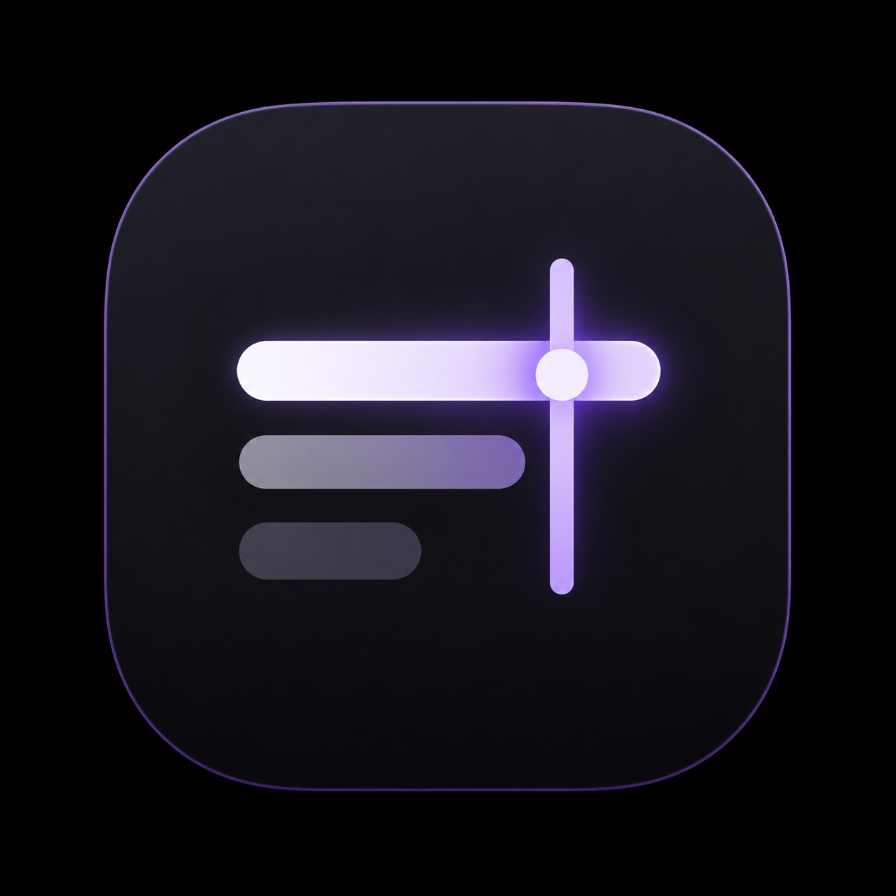
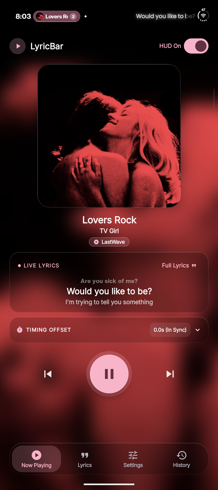
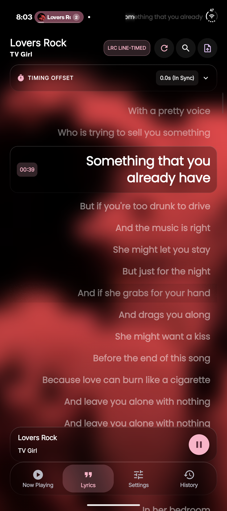
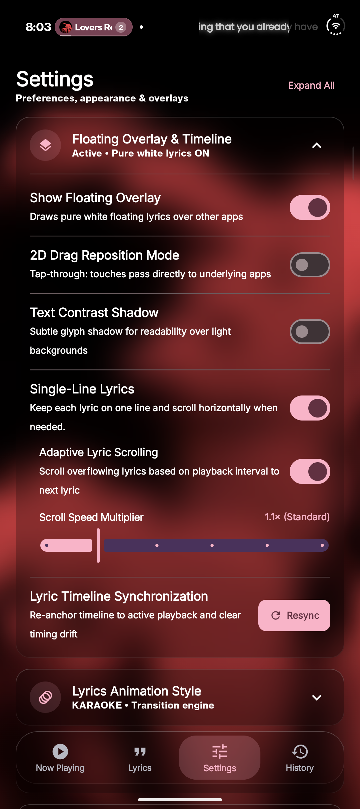
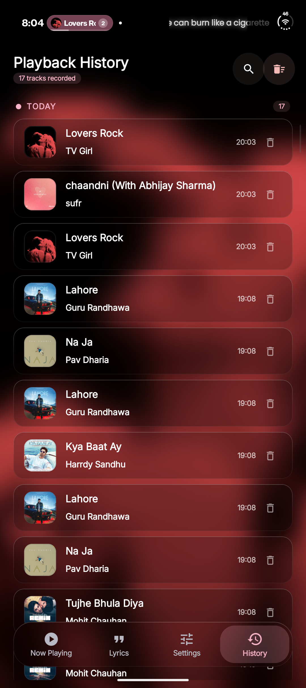
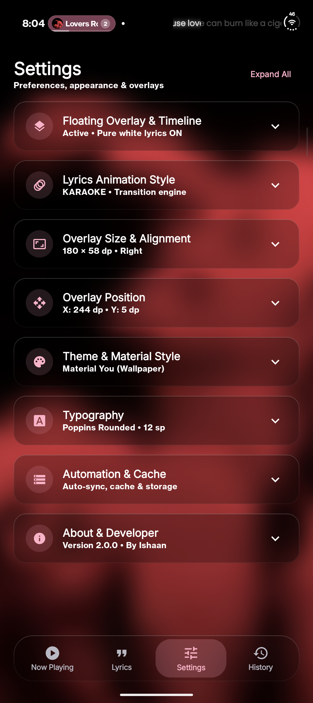

<p align="center">
  
</p>

<h1 align="center">LyricBar</h1>

<p align="center">
  <b>A native Android app for synchronized floating lyrics, frosted-glass aesthetics, and ambient music immersion.</b>
</p>

<p align="center">
  <a href="https://github.com/Ishaanj2007/LyricBar/releases/latest"></a>
  <a href="https://android.com"></a>
  <a href="https://kotlinlang.org"></a>
  <a href="https://developer.android.com/jetpack/compose"></a>
  <a href="LICENSE"></a>
</p>

<p align="center">
  <a href="#screenshots-">Screenshots</a> •
  <a href="#features-">Features</a> •
  <a href="#download-">Download</a> •
  <a href="#requirements-">Requirements</a> •
  <a href="#permissions-">Permissions</a> •
  <a href="#building-from-source-">Building</a> •
  <a href="#license-">License</a>
</p>

---

## Screenshots 📸

| Now Playing | Synchronized Lyrics | Overlay Controls | Playback History | Settings & Themes |
| :---: | :---: | :---: | :---: | :---: |
|  |  |  |  |  |

---

## Features ✨

- **Floating Lyrics Overlay** — Live synchronized lyrics rendered above any active music or media app (Spotify, YouTube Music, Apple Music, local players, etc.).
- **Automatic Media Detection** — Detects active playback state, track metadata, and album artwork via Android's `MediaSession` API.
- **Online & Local Lyrics** — Automatic lyrics lookup via LRCLIB with plain-text fallback, plus direct support for importing and saving local `.lrc` files.
- **Multiple Animation Styles** — Smooth Karaoke glow sweeps, Line Transitions, Fade, Blur Reveal, and Typewriter animations synchronized to playback timing.
- **Customizable Overlay Engine** — Adjust font size (6sp–24sp), opacity, alignment, position, dimensions, custom Google Fonts, and toggle single-line mode.
- **Real-Time Offset Adjustment** — Fine-tune lyric synchronization on the fly with per-track offset adjustments (`-0.5s`, `-0.1s`, `+0.1s`, `+0.5s`).
- **Dark-Only Ambient Design** — Subtle backdrop scrim that lets active album artwork glow through translucent frosted-glass surfaces.
- **Curated & Dynamic Theming** — Curated pastel palettes (Rose Quartz, Lavender Mist, Peach Ember, Sage Serenity), dark presets, and Android 12+ Material You dynamic colors.
- **Playback History** — Chronological timeline grouping (*Today*, *Yesterday*, *Earlier This Week*, *Previous Month*) stored locally with cached artwork thumbnails.
- **In-App Updater** — Built-in updater with cryptographic SHA-256 and signing certificate verification for safe, direct installations from GitHub Releases.
- **Battery & Memory Optimized** — Hardware Canvas rendering locked to display refresh rate, LRU artwork memory caching, and zero-polling lifecycle awareness.

---

## 📲 Download

👉 **[Download the Latest Release](https://github.com/Ishaanj2007/LyricBar/releases/latest)**

1. Download the `LyricBar-2.0.0.apk` from the latest release assets.
2. Open the APK on your Android device.
3. Allow installation from unknown sources if prompted.
4. Launch LyricBar and grant the required permissions (Overlay & Notification Listener).

*Future updates can be checked, downloaded, and verified directly from **Settings → Check for Updates**.*

---

## Requirements 📱

- **Minimum Version:** Android 7.0 (API level 24)
- **Target Version:** Android 15 (API level 35)
- **Permissions:** Notification Listener & Display Over Other Apps
- **Connectivity:** Internet connection for online lyric lookup and updates

### Tech Stack

| Component | Library / Framework |
| :--- | :--- |
| **Language** | Kotlin 2.0.21 |
| **UI Framework** | Jetpack Compose & Material 3 |
| **Blur & Glassmorphism** | Haze 1.3.1 |
| **Local Persistence** | Room 2.6.1 & Jetpack DataStore 1.1.1 |
| **Networking** | OkHttp 4.12.0 & Retrofit 2.11.0 |
| **Concurrency** | Kotlin Coroutines & StateFlow |
| **Architecture** | MVVM with Lifecycle-Aware Compose |

---

## Permissions 🔐

LyricBar requests only the permissions necessary for its core functionality:

- **Display over other apps (`SYSTEM_ALERT_WINDOW`):** Required to display the floating lyrics overlay above other apps.
- **Notification listener access:** Used to read media metadata and synchronize lyrics with the active media session.
- **Internet (`INTERNET`):** Used to fetch lyrics from LRCLIB and check for releases on GitHub.
- **Foreground Service (`FOREGROUND_SERVICE`):** Keeps the floating overlay active while music is playing in the background.
- **Request Install Packages (`REQUEST_INSTALL_PACKAGES`):** Enables the in-app updater to pass verified APKs to the Android Package Installer.
- **Vibration (`VIBRATE`):** Haptic feedback for control interactions.

*Note: Overlay permission and Notification Listener access must be granted manually in Android Settings upon first launch.*

---

## Building from Source 🚀

### 1. Clone the repository

```bash
git clone https://github.com/Ishaanj2007/LyricBar.git
cd LyricBar
```

### 2. Build via Gradle

**Linux / macOS**
```bash
# Build Debug APK
./gradlew :app:assembleDebug

# Run Unit Tests (154 tests)
./gradlew :app:testDebugUnitTest
```

**Windows**
```bat
gradlew.bat :app:assembleDebug
gradlew.bat :app:testDebugUnitTest
```

---

## Project Structure 📂

```text
.
├── Screenshots/
│   ├── Screenshot1_LyricBar.png      # Now Playing Screen
│   ├── Screenshot2_LyricBar.png      # Synchronized Lyrics View
│   ├── Screenshot3_LyricBar.png      # Floating Overlay Controls
│   ├── Screenshot4_LyricBar.png      # Playback History Log
│   ├── Screenshot5_LyricBar.png      # Settings & Material Themes
│   └── lyricbarlogo.png              # App Brand Logo
├── app/
│   ├── build.gradle.kts
│   └── src/
│       ├── main/
│       │   ├── AndroidManifest.xml
│       │   ├── java/com/example/
│       │   │   ├── LyricBarApp.kt
│       │   │   ├── MainActivity.kt
│       │   │   ├── data/             # Room DB, DataStore, Repositories & Updater
│       │   │   ├── domain/           # Lyrics Timing Engine, Parser & Providers
│       │   │   ├── service/          # MediaListener & Overlay Foreground Service
│       │   │   └── ui/               # Compose Screens, Glass Components & Theme
│       │   └── res/                  # Vector Assets, Fonts & XML Providers
│       └── test/                     # 154 Automated Unit Tests
├── build.gradle.kts
├── settings.gradle.kts
└── README.md
```

---

## Privacy 🔒

- Playback state, track titles, and artist names are processed strictly on-device to synchronize lyrics.
- Online lyric lookups send only the song title and artist name to lyric providers (LRCLIB).
- No telemetry, analytics, or personal user data is collected, stored, or transmitted.

---

## License 📄

This project is licensed under the MIT License — see the [LICENSE](LICENSE) file for details.

---

<p align="center">
  Maintained by <a href="https://github.com/Ishaanj2007">Ishaan</a> • Open source and built with Jetpack Compose.
</p>
