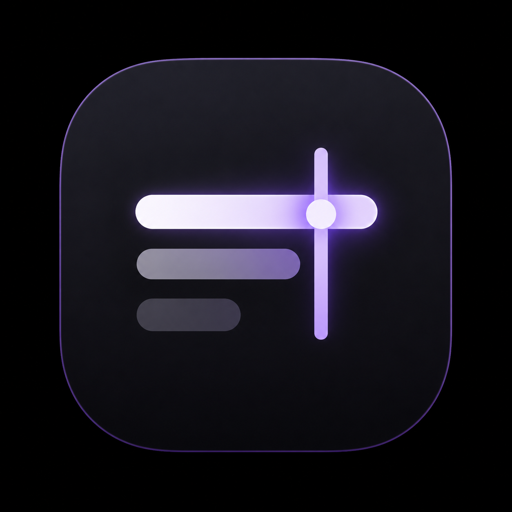
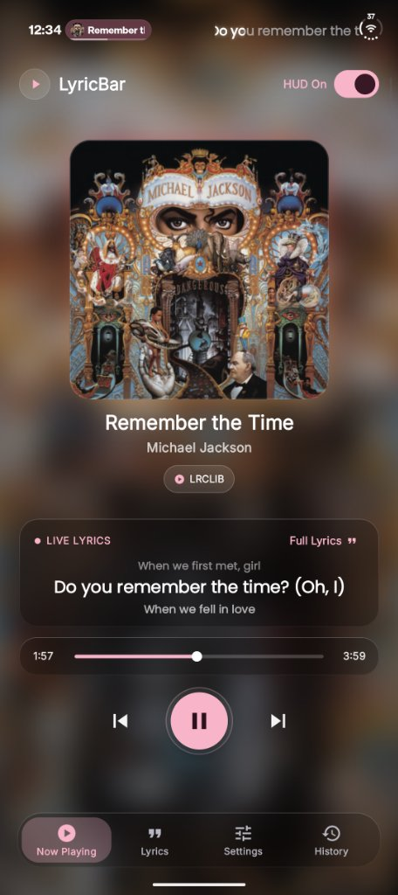
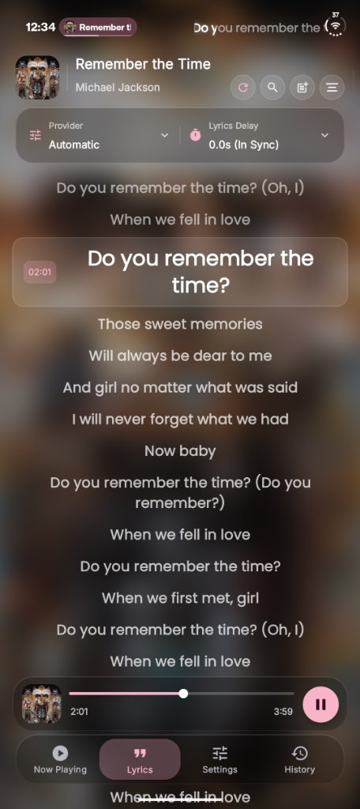
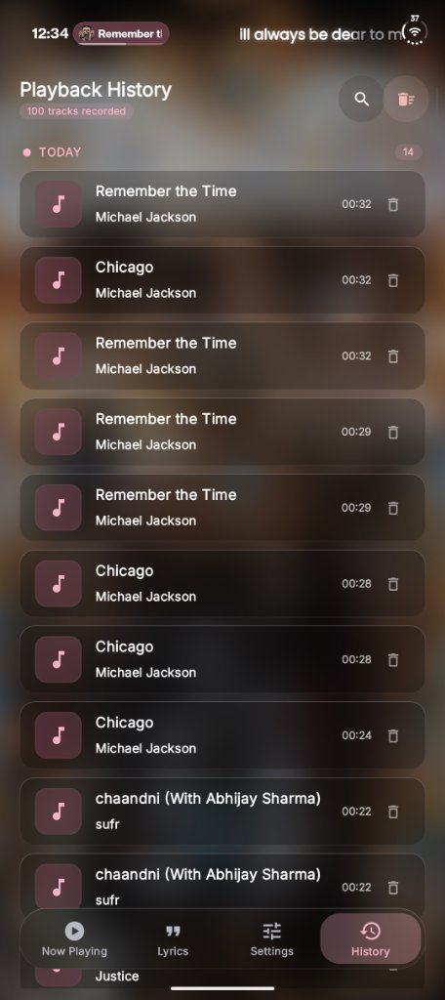
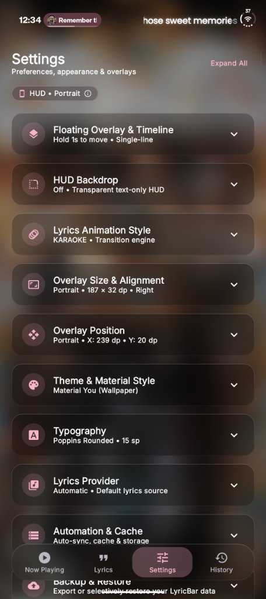

<p align="center">
  
</p>

<h1 align="center">LyricBar</h1>

<p align="center">
  <b>A native Android app for synchronized floating lyrics, adaptive landscape layouts, and customizable ambient music immersion.</b>
</p>

<p align="center">
  <a href="https://github.com/Ishaanj2007/LyricBar/releases/latest"></a>
  <a href="https://android.com"></a>
  <a href="https://kotlinlang.org"></a>
  <a href="https://developer.android.com/jetpack/compose"></a>
  <a href="LICENSE"></a>
</p>

<p align="center">
  <b>LyricBar v2.7.0</b> — Synchronized Floating Lyrics for Android
</p>

<p align="center">
  <a href="#screenshots-">Screenshots</a> •
  <a href="#whats-new-in-v270-">What's New</a> •
  <a href="#features-">Features</a> •
  <a href="#multi-provider-lyrics-architecture-">Lyrics Providers</a> •
  <a href="#floating-hud--customization-">Floating HUD</a> •
  <a href="#automatic-updates--security-">Updates</a> •
  <a href="#download-">Download</a> •
  <a href="#requirements-">Requirements</a> •
  <a href="#permissions-">Permissions</a> •
  <a href="#building-from-source-">Building</a> •
  <a href="#testing--verification-">Testing</a>
</p>

---

## Screenshots 📸

| Now Playing | Synchronized Lyrics | Playback History | Settings & Themes |
| :---: | :---: | :---: | :---: |
|  |  |  |  |

---

## What's New in v2.7.0 🚀

- **Permanent Application ID (`com.ishaan.lyricbar`) & Selective Backup/Restore** — Migrated to LyricBar's permanent package identifier (`versionCode` 11) with a portable `.zip` Backup & Restore system covering App Settings, HUD Configuration, Playback History, and Imported `.lrc` Lyrics, plus allowlist Android Auto Backup and Device-to-Device transfer rules.
- **Dynamic HUD Accent Colour & Independent Alignment** — Optional Palette-based accent colour extraction from active album artwork (`ArtworkAccentExtractor`), a tap-to-cycle alignment toggle on the Lyrics screen, and separate alignment preferences for the Lyrics screen and floating HUD.
- **In-App Feedback Centre & Modernized Update Dialog** — Added a dedicated Feedback Centre in **Settings → About & Developer** with structured diagnostics and templates, plus native Markdown release-notes rendering (`SimpleMarkdownView`) inside the Update Dialog.
- **Artwork, Blur, Font & Provider Hardening** — Eliminated album artwork flickering, prevented stale async blur results from rendering over newly switched tracks, added LRU eviction to `ArtworkMemoryCache`, cached overlay `Typeface` resources process-wide, and hardened cancellation/response cleanup across all 7 lyrics providers.
- **Release Optimization & Modularization** — Enabled R8 code minification and resource shrinking, configured permanent release signing, modularized `MinimalOverlayView`, and expanded the automated unit test suite to 438 tests.

---

## Features ✨

- **Multi-Provider Lyrics Engine** — Broad song coverage powered by seven synchronized providers (`LRCLIB`, `lrc.red`, `LyricsPlus`, `KuGou`, `Lyrica`, `LiriQo`, `Unison`) with priority fallback and safe TTML-to-line-synced conversion (`TtmlParser`).
- **Synchronized Provider Selection** — Choose between `Automatic` and any individual provider directly from either the **Lyrics Screen** (frosted floating dropdown) or **Settings Screen**, sharing the same persistent DataStore preference.
- **Responsive Portrait & Landscape UI** — Streamlined **Now Playing**, **Lyrics**, **History**, and **Settings** screens that adapt seamlessly between compact phones (`FloatingBottomNavPill`) and wide/landscape screens (`AdaptiveNavRail` + two-column layouts).
- **Orientation-Aware Floating Lyrics Overlay** — Live synchronized lyrics rendered above any active music or media app (Spotify, YouTube Music, Apple Music, local players, etc.) with separate persistent **Portrait** and **Landscape** positioning profiles.
- **Interactive HUD Gestures & Click-through Mode** — Short-tap the HUD to resync, triple-tap anywhere on the interactive HUD to open LyricBar, hold for `1000 ms` to reposition safely (with automatic rollback on cancellation), toggle 2D Drag & Resize handles, or enable **Click-through Overlay** to pass all touches to the app underneath.
- **Dedicated HUD Backdrop & Independent Lyric Colours** — Configure a text-only HUD or crisp **Black** / **Grey** backdrops inside the dedicated **HUD Backdrop** section with live preview, opacity, corner radius, padding, independent **Active** and **Inactive** lyric colours, HSV/Hex picker, saved swatches, and contrast warnings.
- **Cinematic Ambient Artwork Glow** — Dynamic diffused ambient illumination engine derived from active album artwork palettes for in-app frosted-glass surfaces.
- **Intelligent Auto-Scroll with Reading Pause** — Smooth automatic lyric following that pauses instantly when the user scrolls manually and provides a one-tap resume affordance.
- **Eligible MediaSession Detection** — Filters active `MediaSession` updates by app context, playback state, duration, and metadata signals (`MediaSessionEligibility`) to ignore non-music video/browser sessions and prevent stale lyrics or history pollution.
- **Safe & Bounded Local LRC Import** — Bounded, memory-safe local `.lrc` import system with UTF-8/UTF-16/BOM auto-detection and file-size protection.
- **Multiple Animation Styles** — Apple-style Karaoke glow sweeps, Smooth Line Transitions, Fade, Blur Reveal, Typewriter, and Instant animations synchronized to playback timing.
- **Typography & Timing Precision** — Customize HUD text size, opacity, alignment, single-line mode, 12 bundled Google Fonts (`Inter`, `Poppins`, `Montserrat`, `Lora`, `Roboto Mono`, etc.), and per-track lyric offsets (`-0.5s`, `-0.1s`, `+0.1s`, `+0.5s`).
- **Curated & Dynamic Theming** — Follow System / Light / Dark modes, curated pastel palettes (*Rose Quartz*, *Lavender Mist*, *Peach Ember*, *Sage Serenity*), and Android 12+ Material You dynamic colors.
- **Playback History** — Chronological timeline grouping (*Today*, *Yesterday*, *Earlier This Week*, *Previous Month*) stored locally with cached artwork thumbnails.
- **Hardened & Automatic GitHub Updater** — Periodic 48-hour background checks with notification alerts, ETag caching, SHA-256 verification, package identity matching, downgrade prevention, and signing certificate lineage verification.
- **Battery & Memory Optimized** — Zero-allocation hardware Canvas draw loops locked to display refresh rate, LRU artwork memory caching, and lifecycle-aware synchronization.

---

## Multi-Provider Lyrics Architecture 🎵

LyricBar uses a modular, 7-tier lyrics provider architecture to maximize regional, international, and community-curated synchronized lyrics coverage:

| Priority | Provider | Identification Method | Strengths |
| :---: | :--- | :--- | :--- |
| **1** | **LRCLIB** | Title, Artist, Album, Duration | Community-driven synchronized LRC catalog with broad international coverage. |
| **2** | **lrc.red** | ISRC, Title, Artist | Exact recording identification via ISRC with synchronized line timing. |
| **3** | **LyricsPlus** | Title, Artist, Album, Duration | Fast multi-mirror synchronized lyrics aggregator with slow-mirror cancellation. |
| **4** | **KuGou** | Title, Artist, Duration | Large catalog with fuzzy candidate scoring and decrypted KRC line-level timing. |
| **5** | **Lyrica** | Artist, Title (`fast=true`) | Strong coverage across Hindi, Bollywood, Marathi, Punjabi, Tamil, Telugu, and global tracks. |
| **6** | **LiriQo** | Title, Artist, Duration, Album, ISRC | International and Asian catalog with strict recording-version and artist validation across multi-track candidates. |
| **7** | **Unison** | ISRC, Title, Artist, Search + Video ID | Community-submitted LRC and TTML lyrics (`TtmlParser`) with `ETag`/`304` caching and clickable song & curator attribution. |

### Provider Selection & Cache Isolation
- **Automatic Mode (`AUTO`):** Queries `LRCLIB → lrc.red → LyricsPlus → KuGou → Lyrica → LiriQo → Unison` in fallback priority order and stops at the first valid synchronized lyrics result.
- **Manual Mode:** When a specific provider (`LRCLIB`, `lrc.red`, `LyricsPlus`, `KuGou`, `Lyrica`, `LiriQo`, or `Unison`) is selected, LyricBar queries **only** that provider without falling back, presenting the missing-lyrics state if unavailable.
- **Dual-Screen Synchronization:** The provider selector is accessible from both the **Lyrics Screen** (scrollable frosted floating menu) and the **Settings Screen** (*Lyrics Provider* section), backed by a shared Jetpack DataStore preference.
- **Cache Isolation & Attribution Persistence:** Room database caching isolates entries by provider (`<identityKey>::provider::<name>`). Manual provider selection never returns cached lyrics from a different provider, switching providers preserves existing cache records, and Unison song/curator attribution metadata (`[x-attribution-*]`) survives offline Room cache reloads.
- **Transparent Source Attribution:** The active lyrics source is displayed on Now Playing (`LRCLIB`, `lrc.red`, `LyricsPlus`, `KuGou`, `Lyrica`, `LiriQo`, `Unison`, or `Local Import`), and Unison tracks render clickable **Lyrics from Unison** and **Curated by &lt;name&gt;** links directly below the lyrics.

---

## Floating HUD & Customization 🎛️

- **Orientation Profiles (`HudPositioningEngine`)**: Portrait and Landscape each persist independent `X`, `Y`, `Width`, and `Height` values in DataStore, clamped safely away from status bars, navigation bars, and display cutouts.
- **Touch Interaction (`HudHoldGestureController`, `HudTripleTapDetector`, `HudDragTransactionCoordinator`)**:
  - **Short Tap**: Triggers lyric playback resync.
  - **Triple-Tap**: Opens LyricBar's `MainActivity` from the interactive HUD (disabled automatically when Click-through or 2D Drag mode is active; ignores long presses, drags, multi-pointer input, and 4th+ taps).
  - **1-Second Hold (`1000 ms`)**: Enters reposition mode with subtle neutral visual feedback; dragging updates the HUD smoothly and saves to the active orientation profile on release.
  - **Click-through Overlay Mode**: Makes the overlay window non-touchable (`FLAG_NOT_TOUCHABLE`) so all taps and gestures pass through to apps underneath.
  - **Safety**: Cancels pending holds on touch slop, multi-pointer input, or control touches, and rolls back active drags to original coordinates if interrupted or cancelled.
- **Dedicated HUD Backdrop & Colour Hierarchy (`HudColorSystem`)**:
  - Dedicated **HUD Backdrop** Settings card featuring live preview, **Black** (`#0A0A0A`) or **Grey** (`#B8B8B8`) style, adjustable opacity (`0%–100%`), corner radius (`0–32 dp`), and horizontal/vertical padding.
  - Independent **Active Lyric** and **Inactive Lyric** colours via curated presets, full HSV/Hex custom picker, up to 8 saved custom swatches, contrast readability warnings, and a `0.64f` inactive opacity ratio so the currently sung line stays visually prominent.

---

## Automatic Updates & Security 🔄

- **48-Hour Periodic Checks (`UpdateCheckScheduler`, `UpdateCheckWorker`)**: Powered by Android WorkManager (`NetworkType.CONNECTED`, exponential backoff, `ExistingPeriodicWorkPolicy.KEEP`), paired with overdue app-launch checks (`>= 48h` since last successful check).
- **Shared Update Pipeline (`UpdateCheckEngine`)**: Both manual and automatic checks share a `Mutex`-protected coordinator, ignore drafts/prereleases, select ABI-compatible APKs, and use GitHub API **ETags** (`If-None-Match` / `304 Not Modified`) to save bandwidth and API quota.
- **Deduplicated Notifications (`UpdateNotifier`)**: Posts on channel `lyricbar_app_updates` only once per newer version (persisting `lastNotifiedUpdateVersion` strictly after notification delivery succeeds) and opens the **Update Dialog** in Settings when tapped.
- **Manual Confirmation Only**: Updates are never downloaded or installed silently — all installations require explicit user confirmation and pass package-name, version-downgrade, signing-certificate, and SHA-256 verification. Can be toggled at any time in **Settings → About & Developer → Automatic update checks**.

---

## Download 📲

> [!IMPORTANT]
> **Upgrading from v2.6.x to v2.7.0+ (Package ID Migration):**  
> In **v2.7.0**, LyricBar's official application ID transitioned to its permanent identifier `com.ishaan.lyricbar`. Because Android treats apps with different package IDs as separate applications, in-app auto-update cannot overwrite v2.6.x directly.  
> **To migrate your data seamlessly:**
> 1. In your existing v2.6.1 app, navigate to **Settings → Backup & Restore** and tap **Export Backup** to save a `.zip` archive to your device or Google Drive.
> 2. Download and install `LyricBar-2.7.0.apk` from GitHub Releases. It will install alongside your existing app.
> 3. Launch LyricBar v2.7.0, grant the required permissions (Overlay & Notification Listener), navigate to **Settings → Backup & Restore**, tap **Restore Backup**, and select your exported `.zip` file.
> 4. Once your HUD customisation, history, and imported lyrics are restored, you can safely uninstall the old v2.6.x app.

👉 **[Download the Latest Release](https://github.com/Ishaanj2007/LyricBar/releases/latest)**

1. Download `LyricBar-2.7.0.apk` (or architecture-specific variant) from the latest release assets.
2. Open the APK on your Android device.
3. Allow installation from unknown sources if prompted.
4. Launch LyricBar and grant the required permissions (Overlay & Notification Listener).

*Automatic update checks run every 48 hours by default, and manual checks are always available under **Settings → About & Developer → Check for Updates**.*

---

## Requirements 📱

- **Minimum Version:** Android 7.0 (API level 24)
- **Target Version:** Android 15 (API level 35)
- **Permissions:** Notification Listener & Display Over Other Apps
- **Connectivity:** Internet connection for online lyric lookup and updates

### Tech Stack

| Component | Library / Framework |
| :--- | :--- |
| **Language** | Kotlin 2.0.21 |
| **UI Framework** | Jetpack Compose & Material 3 (BOM 2024.10.01) |
| **Frosted Glass Effects** | Haze 1.3.1 |
| **Local Persistence** | Room 2.6.1 & Jetpack DataStore 1.1.1 |
| **Background Scheduling** | AndroidX WorkManager 2.10.0 |
| **Networking** | OkHttp 4.12.0 |
| **Concurrency** | Kotlin Coroutines 1.9.0 & StateFlow |
| **Architecture** | MVVM with Lifecycle-Aware Compose |

---

## Permissions 🔐

LyricBar requests only the permissions necessary for its core functionality:

- **Display over other apps (`SYSTEM_ALERT_WINDOW`):** Required to display the floating lyrics overlay above other apps.
- **Notification listener access:** Used to read media metadata and synchronize lyrics with the active media session.
- **Internet (`INTERNET`):** Used to fetch lyrics from online providers and check/download verified releases on GitHub.
- **Post Notifications (`POST_NOTIFICATIONS`, Android 13+):** Used for the foreground overlay notification and optional update-available notifications (if declined, in-app update checks still appear in Settings).
- **Foreground Service (`FOREGROUND_SERVICE` / `FOREGROUND_SERVICE_SPECIAL_USE`):** Keeps the floating overlay active while music is playing in the background.
- **Request Install Packages (`REQUEST_INSTALL_PACKAGES`):** Enables the in-app updater to pass verified APKs to the Android Package Installer.
- **Vibration (`VIBRATE`):** Haptic feedback for hold-to-reposition and control interactions.

*Note: Overlay permission and Notification Listener access must be granted manually in Android Settings upon first launch.*

---

## Building from Source 🚀

### 1. Clone the repository

```bash
git clone https://github.com/Ishaanj2007/LyricBar.git
cd LyricBar
```

### 2. Build via Gradle

The repository includes an automatic debug keystore restoration hook in `build.gradle.kts` so fresh clones can assemble debug builds immediately without developer-specific machine setup.

**Linux / macOS**
```bash
# Ensure Unix wrapper has execution permissions
chmod +x gradlew

# Build Debug APK
./gradlew :app:assembleDebug

# Run Unit Tests (438 tests across 47 suites)
./gradlew :app:testDebugUnitTest

# Compile Android Instrumented Tests
./gradlew :app:compileDebugAndroidTestKotlin
```

**Windows**
```bat
gradlew.bat :app:assembleDebug
gradlew.bat :app:testDebugUnitTest
gradlew.bat :app:compileDebugAndroidTestKotlin
```

---

## Testing & Verification 🧪

LyricBar maintains automated test coverage across its data, parsing, HUD positioning/gesture/colour, synchronization, and updater layers:

| Test Scope | Count | Status | Notes |
| :--- | :---: | :---: | :--- |
| **Local JVM Unit Tests** | 438 | **Passing (100%)** | 47 test suites in `app/src/test/java/` covering the 7-provider fallback chain (`LRCLIB`, `lrc.red`, `LyricsPlus`, `KuGou`, `Lyrica`, `LiriQo`, `Unison`), `TtmlParser`, LRC import bounds, portable `.zip` Backup & Restore, `MediaSession` eligibility & pipeline filtering, HUD orientation positioning & modular layout/gesture engines, 1s hold-to-reposition & drag rollback, Click-through overlay mode, Triple-tap HUD launch, Settings accordion state, HUD colour/contrast & dynamic accent system, Room migrations, and 48h WorkManager updater / notification deduplication. |
| **Executed Test Cases** | 438 | **438 Passed (0 failed)** | Verified via `:app:testDebugUnitTest`. |
| **Instrumented Tests** | 1 | **Configured & Compiles** | Located in `app/src/androidTest/java/` using AndroidX Test Runner and JUnit4. |
| **Total Test Methods** | 439 | — | 438 local unit tests + 1 instrumented test. |

---

## Project Structure 📂

```text
.
├── .github/
│   ├── workflows/
│   │   └── ci.yml                    # Automated GitHub Actions CI workflow
│   └── ISSUE_TEMPLATE/
├── Screenshots/
│   ├── Screenshot1_NowPlaying.jpg    # Now Playing Screen
│   ├── Screenshot2_Lyrics.jpg        # Synchronized Lyrics View
│   ├── Screenshot3_History.jpg       # Playback History Log
│   ├── Screenshot4_Settings.jpg      # Settings & Material Themes
│   └── lyricbarlogo.png              # App Brand Logo
├── app/
│   ├── build.gradle.kts              # Application build config & dependencies
│   └── src/
│       ├── main/
│       │   ├── AndroidManifest.xml
│       │   ├── java/com/example/
│       │   │   ├── LyricBarApp.kt
│       │   │   ├── MainActivity.kt
│       │   │   ├── data/             # Room DB, DataStore, Repositories & 48h WorkManager Updater
│       │   │   ├── domain/           # Lyrics Timing Engine, LRC/TTML Parsers & 7-Provider Clients
│       │   │   ├── service/          # MediaListener, Eligibility Filter, Overlay Service & HudPositioningEngine
│       │   │   └── ui/               # Responsive Compose Screens, MinimalOverlayView & Theme
│       │   └── res/                  # Vector Assets, Bundled Google Fonts & XML Configs
│       ├── test/                     # 438 Local Automated Unit Tests (47 test suites)
│       └── androidTest/              # Instrumented Android Tests
├── gradle/
│   ├── libs.versions.toml            # Version Catalog
│   └── wrapper/
│       ├── gradle-wrapper.jar
│       └── gradle-wrapper.properties
├── build.gradle.kts                  # Root buildscript with clean-clone key restoration
├── settings.gradle.kts
├── debug.keystore.base64             # Base64-encoded debug keystore for clean-clone reproducibility
├── LICENSE
└── README.md
```

---

## Known Limitations ⚠️

1. **Dynamic Theming on Android 11 & Earlier**: Android 12+ (API 31+) is required for system Material You wallpaper color extraction. On Android 7.0–11, curated pastel palettes (*Rose Quartz*, *Lavender Mist*, *Peach Ember*, *Sage Serenity*) provide theme customization.
2. **System Overlay Restrictions**: On certain Android vendor skins (MIUI/HyperOS, ColorOS, EMUI), background pop-up permissions and aggressive battery optimizations may require manual configuration in system settings.
3. **Protected Streams**: Media apps that do not publish standard Android `MediaSession` metadata or playback positions cannot provide timing data for synchronization.

---

## Contributing 🤝

Contributions are welcome! Please follow these guidelines:

1. Fork the repository and create a feature branch (`git checkout -b feature/amazing-feature`).
2. Make your changes and ensure all tests pass:
   ```bash
   ./gradlew :app:testDebugUnitTest
   ./gradlew :app:compileDebugAndroidTestKotlin
   ```
3. Commit your changes with clear, descriptive commit messages.
4. Push to your branch and open a Pull Request.

---

## License 📄

This project is licensed under the MIT License — see the [LICENSE](LICENSE) file for details.

---

<p align="center">
  Maintained by <a href="https://github.com/Ishaanj2007">Ishaan</a> • Open source and built with Jetpack Compose.
</p>
