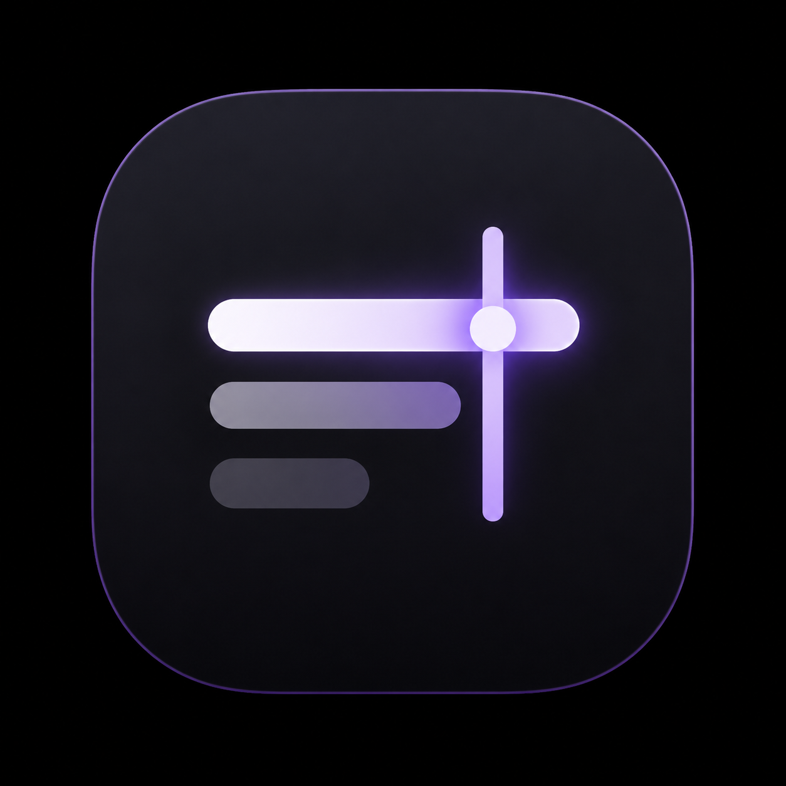
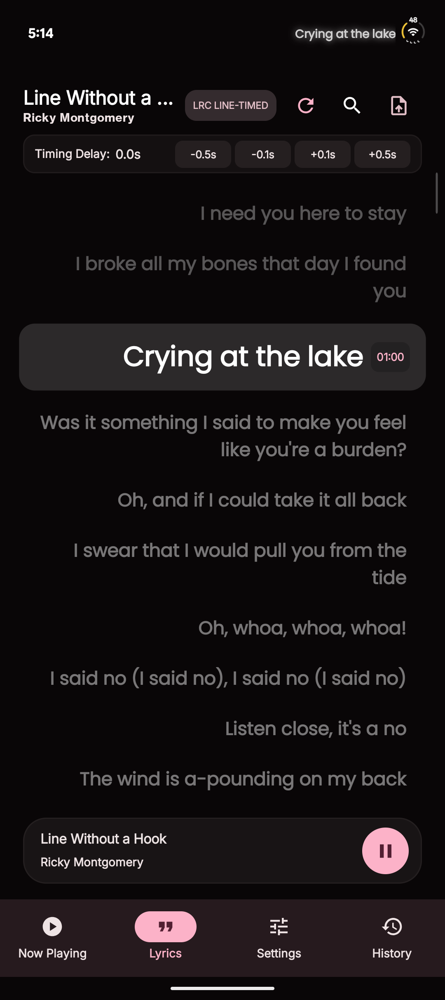
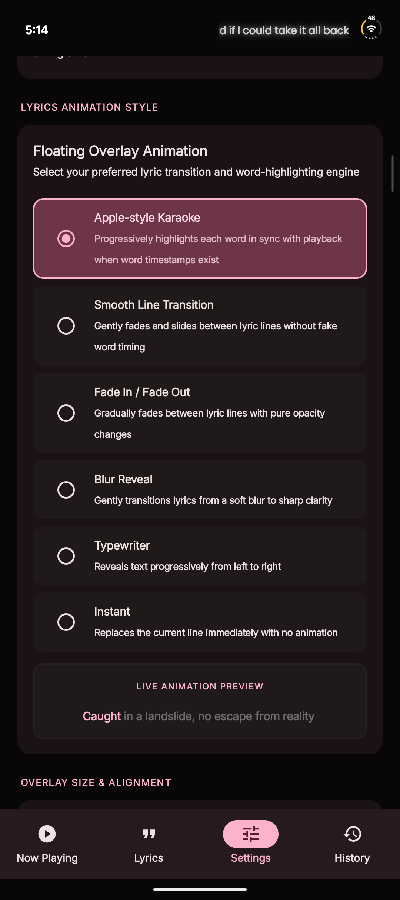
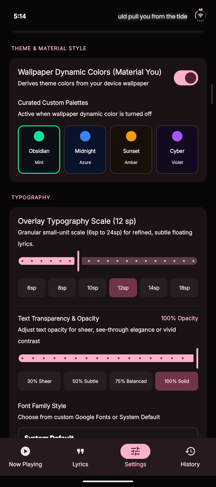
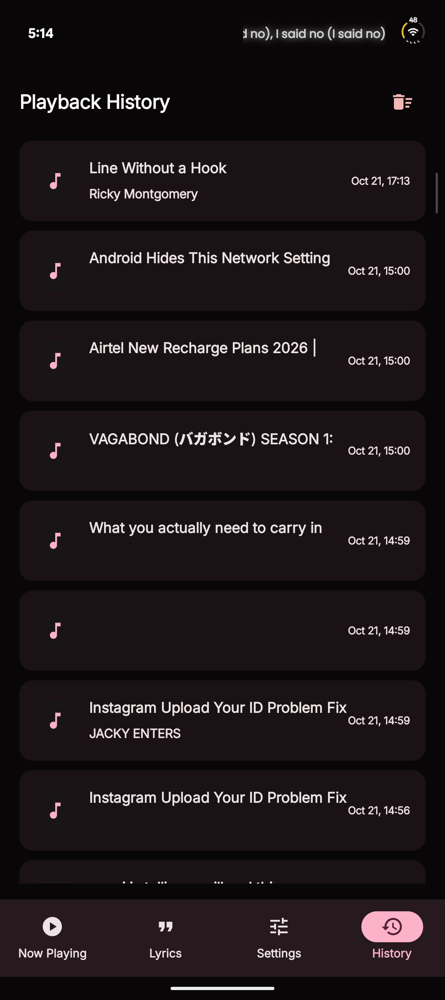

<p align="center">
  
</p>

<h1 align="center">LyricBar</h1>

<p align="center">
  <b>A native Android app for synchronized floating song lyrics overlay</b>
</p>

<p align="center">
  <a href="#features-">Features</a> •
  <a href="#screenshots-%EF%B8%8F">Screenshots</a> •
  <a href="#requirements-">Requirements</a> •
  <a href="#permissions-">Permissions</a> •
  <a href="#getting-started-">Getting Started</a> •
  <a href="#license-">License</a>
</p>

---

> **Project status:** Under active development. Features and behavior may change while improvements and fixes are being made. Please test on your device before relying on timing-sensitive lyrics.

## A little note about the code 🤖

LyricBar is kinda **vibe-coded** — AI tools helped write and tweak parts of the code. So yeah, some bugs or weird AI moments might slip through. If something breaks, don't roast the app too hard! Open an issue describing what happened and how to reproduce it, and I'll check it out and try to fix it ASAP.

AI helped write the code, but I'm still the developer maintaining the project. Bug reports, suggestions, and PRs are always welcome!

## Screenshots 📸

| Synchronized Lyrics | Overlay Animation Engine | Material You & Typography | Playback History |
| :---: | :---: | :---: | :---: |
|  |  |  |  |

## Features ✨

- **Floating Lyrics Overlay** — Display live synchronized lyrics over any active music or media app.
- **Automatic Media Detection** — Detect song metadata, playback state, and album art via Android's MediaSession API.
- **Online Lyrics Lookup** — Fetch synchronized lyrics using LRCLIB, with Lyrics.ovh as a plain-lyrics fallback.
- **Local Lyrics Import** — Easily import `.lrc` lyric files directly from local storage using Android's document picker.
- **Multiple Animation Styles** — Choose from Apple-style Karaoke, Smooth Line Transition, Fade In / Fade Out, Blur Reveal, Typewriter, and Instant transitions with real-time preview.
- **Customizable Overlay Engine** — Fine-tune text size (6sp–24sp), transparency/opacity, custom Google Fonts, text alignment, position, dimensions, and single-line mode.
- **Lyric Timing Offset** — Adjust synchronization in real-time with per-track offset adjustments (`-0.5s`, `-0.1s`, `+0.1s`, `+0.5s`).
- **Playback History** — Store playback history locally using Room database.
- **Saved Preferences** — Retain all app configuration and overlay preferences using DataStore.
- **Dynamic Material You Theming** — Material 3 interface with wallpaper-based dynamic colors on supported Android versions, alongside curated custom color presets (Obsidian, Midnight, Sunset, Cyber).

> **Note:** Precise word-by-word karaoke highlighting depends on the lyric source providing word-level timestamps. Standard LRC files usually provide line-level timing only.

## Requirements 📱

- Android Studio with a compatible Android Gradle Plugin and Kotlin toolchain.
- Android SDK matching the project's configured `compileSdk`.
- Minimum Android version: **Android 7.0 (API 24)**.
- Internet connection for online lyric lookup.

### Tech Stack

- **Kotlin** & **Jetpack Compose**
- **Material 3** (Dynamic Color / Material You)
- **Room Database** & **Jetpack DataStore**
- **Kotlin Coroutines** & **Flow**
- **Retrofit** & **OkHttp**

## Permissions 🔐

LyricBar requires the following permissions for its core features:

- **Display over other apps (`SYSTEM_ALERT_WINDOW`):** Required for rendering the floating lyrics overlay above other apps.
- **Notification listener access:** Used to detect active media sessions and synchronize lyrics with currently playing media.
- **Internet access:** Required for fetching lyrics from online API providers.
- **Foreground Service & Notifications:** Used to run the persistent overlay service on supported Android versions.
- **Vibration:** Haptic feedback for control interactions.

*Note: Overlay permission and Notification Listener access must be granted manually in Android Settings upon first launch.*

## Getting Started 🚀

### 1. Clone the repository

```bash
git clone https://github.com/ishaanj2007/LyricBar.git
```

### 2. Open the project

1. Open Android Studio.
2. Select **Open**.
3. Choose the cloned `LyricBar` project folder.
4. Allow Gradle to sync.
5. Install any requested Android SDK components.

### 3. Run the app

Connect an Android device with USB debugging enabled or launch an emulator.

Select the `app` run configuration and click **Run**.

### Command-line build

You can build and test the project using the included Gradle wrapper:

**Linux / macOS**
```bash
./gradlew :app:assembleDebug
./gradlew :app:testDebugUnitTest
```

**Windows**
```bat
gradlew.bat :app:assembleDebug
gradlew.bat :app:testDebugUnitTest
```

## Testing 🧪

Unit tests are included covering key components:

- LRC parser & timestamp synchronization
- Karaoke highlighting logic
- Smooth line transition speeds & opacity algorithms
- Fade and blur reveal animation performance
- Offline storage & repository unit tests

To run unit tests:
```bash
./gradlew :app:testDebugUnitTest
```

## Project Structure 📂

```text
.
├── Screenshots/
│   ├── LyricBar_ss.png
│   ├── LyricBar_ss2.png
│   ├── LyricBar_ss3.png
│   ├── LyricBar_ss4.png
│   └── lyricbarlogo.png
├── app/
│   ├── build.gradle.kts
│   └── src/
│       ├── androidTest/
│       ├── main/
│       │   ├── AndroidManifest.xml
│       │   ├── assets/
│       │   ├── java/
│       │   │   └── com/
│       │   │       └── example/
│       │   │           ├── LyricBarApp.kt
│       │   │           ├── MainActivity.kt
│       │   │           ├── data/
│       │   │           ├── domain/
│       │   │           ├── service/
│       │   │           └── ui/
│       │   └── res/
│       └── test/
├── build.gradle.kts
├── settings.gradle.kts
├── gradlew
├── gradlew.bat
├── gradle.properties
├── metadata.json
├── LICENSE
├── gradle/
│   ├── libs.versions.toml
│   └── wrapper/
│       ├── gradle-wrapper.jar
│       └── gradle-wrapper.properties
└── README.md
```

## Privacy 🔒

- Song titles, artist names, and playback state are used solely to query lyric providers and synchronize lyrics on your device.
- Online lyric searches transmit required song metadata to selected providers (e.g. LRCLIB, Lyrics.ovh). No personal user data is collected or tracked.

## License 📄

This project is licensed under the MIT License - see the [LICENSE](LICENSE) file for details.

---

Made with ❤️ and a bit of vibe coding.
